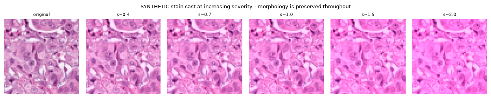
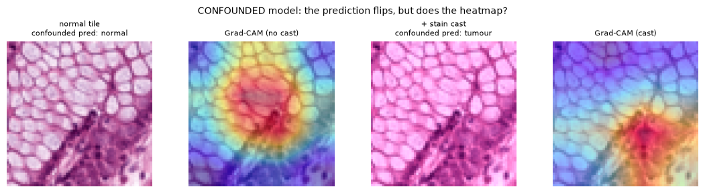

# Module 10: Medical Imaging AI - Build It, Then Break It
## A stain colour cast defeats a 100%-accurate tumour classifier

Rakesh Vayigandla · BIOT 6900 · Computational Lab 10

---

## 1. The confounder, and why it is a realistic batch effect

My artifact is a **stain / scanner colour cast**: a global per-channel gain (red and blue up, green down) plus a mild gamma lift, pushing a tile toward an eosin-heavy pink. It is applied to **every tumour tile, in training and in validation**, as though those slides had been processed somewhere else.

**Stain variation is the canonical batch effect in digital pathology.** Haematoxylin and eosin are biological dyes: batches vary, staining times drift, section thickness differs, and every scanner imposes its own white balance and colour profile. The variation is large enough that stain normalisation is a routine preprocessing step in the field, which is itself an admission that the problem is real and pervasive.

The confounding arises from **logistics, not biology**. If a hospital routes resections to one laboratory and biopsies to another, or if tumour-rich referral cases are processed at a different centre from screening material, then one site's colour signature becomes correlated with the diagnosis. No label needs to be wrong for this to happen; the correlation is manufactured entirely by workflow. A model trained on pooled multi-site data can then learn "that site's pink" as a proxy for cancer, and it will do so happily, because the shortcut is easier to extract than cellular morphology.

**Why it is a harder test than the ink mark from Notebook 2.** A pen mark is *local*: it occupies a fixed patch of the tile, and Grad-CAM can put a red blob on it. A colour cast is **global**: it modifies every pixel and has no location at all. As §3 shows, this difference turns out to matter more than I anticipated.

**Choosing the severity against the control, before training anything.** The assignment warns that an artifact which fools even a clean model proves nothing. So rather than pick a strength and hope, I first measured the **clean model's** flip rate across a severity ladder:

| cast strength `s` | 0.4 | 0.7 | **1.0** | 1.5 | 2.0 |
|---|---|---|---|---|---|
| clean-model flip rate | 6.0% | 6.3% | **5.0%** | 4.7% | 4.7% |

The clean model is robust across the entire range: it never exceeds 6.3%. I chose **`s = 1.0`**: the subtlest setting that still reads unambiguously as a different laboratory's stain, with tissue morphology completely intact. I deliberately avoided the most extreme setting; a garish cast would be easier to learn but far weaker as a claim about *realistic* batch effects.

---

## 2. The models

Both models are the same fine-tuned, ImageNet-normalised **DenseNet121**, trained for 3 epochs on 600 tiles (300 per class) with `SEED = 0`. The only difference is whether tumour tiles carry the cast.

| | clean model | confounded model (`s=1.0`) |
|---|---|---|
| validation accuracy | 0.968 | **1.000** |
| test accuracy (clean data) | **0.950** | **0.583** |

The confounded model reports **perfect validation accuracy, better than the honest model's.** On the metric most projects report, it is the superior model. That is the entire problem in one line: **if validation accuracy were all I checked, I would have shipped the worse model.**

---

## 3. The evidence

### 3.1 What the heatmaps show, and the finding I did not expect

On the clean model, Grad-CAM sits on tissue interior (nuclei-dense and glandular regions) rather than on borders or blank space. Occlusion broadly corroborates it, though only loosely: the two maps correlate at **+0.200**, a reminder that two saliency methods built on different principles agree less than their confident visuals suggest.

On the confounded model I ran Grad-CAM on the *same* normal tile with and without the cast. The prediction flips from **normal to tumour**. The maps:

| comparison | correlation |
|---|---|
| Grad-CAM, cast vs no cast | **+0.089** |
| occlusion, cast vs no cast | **-0.014** |

I had expected the maps to stay roughly put while the prediction flipped. **They do the opposite: they change almost completely.** But the change is uninformative: the heat moves *from tissue to other tissue*. At no point does either map indicate the actual cause, because the cause is a property of every pixel simultaneously and a spatial map has no axis on which to express it.

**This is the trap.** A reviewer applying the checklist's first question (*is the heat on plausible morphology?*) gets a **pass** in both conditions, for a model that is worthless on honest data. Saliency maps answer *where in this tile the evidence is*; my confounder does not live at a "where". An entire class of confounders is invisible to the interpretability tools we reach for first, and nothing about the maps themselves warns you of it.

### 3.2 The reliance test

| | tumour recall **with** cast | **without** cast | change |
|---|---|---|---|
| confounded model | 1.000 | **0.167** | **-0.833** |
| clean model | 0.953 | 0.943 | -0.010 |

Strip the cast away and the confounded model finds **one tumour in six**. It cannot recognise cancer in tiles that look like ordinary slides, because it was never looking at cancer. The clean model's recall is unmoved (-0.010), confirming the cast destroys no diagnostic information: the morphology is still there, and an honest model still reads it.

### 3.3 The flip rate, and the clean control

Adding the cast to all 300 **normal** test tiles:

| model | called tumour |
|---|---|
| **clean model (the control)** | **5.0%** |
| confounded model | **81.7%** |
| | **16.3×** |

This comparison is load-bearing. The clean model, shown the identical images, almost entirely refuses to flip. That rules out the alternative explanation, "any unfamiliar input confuses any network", which is exactly what invalidated the dark-edge-band attempt described in Notebook 2. Because the honest model shrugs the cast off, the confounded model's 81.7% can only be attributed to the artifact **it specifically learned**.

### 3.4 Dose-response

| cast `s` | confounded val acc | recall with → without | flip: control vs confounded | confounded acc on clean data |
|---|---|---|---|---|
| 1.0 | 1.000 | 1.000 → 0.167 | 5.0% vs **81.7%** | **0.583** |
| 2.0 | 1.000 | 1.000 → **0.023** | 4.7% vs **97.0%** | **0.512** |

Every measure of reliance strengthens as the cast strengthens, while the control stays flat. Coincidences do not usually arrive with a dose-response curve; this is a further control on the claim.

---

## 4. Verdict

**The model learned the shortcut.** Four independent lines of evidence agree, and the control rules out the main alternative explanation.

1. Validation accuracy was **perfect and better than the honest model's**: the metric that would have justified deployment is the one most thoroughly fooled.
2. **Removing the cast collapses tumour recall to 0.167**, while the clean model loses 0.010 on the same images.
3. **Adding the cast to healthy tissue produces a cancer call 81.7% of the time.**
4. **The clean control flips 5.0%**, a 16.3× gap.

The decisive number is this: **on clean, uncontaminated test data the confounded model scores 0.583, against 0.950 for the honest model.** A classifier reporting *perfect* validation accuracy performs barely above chance on honest data. It learned nothing whatsoever about tumour morphology, and it is important that the real signal was fully available to it. The cast preserves every nucleus and gland; an honest model trained on the same tiles reaches 0.950. The confounded model had the genuine feature within reach and took the cheaper one anyway, because gradient descent optimises for the loss, not for the reasoning we would have preferred.

**What the control implies.** Without it, the 81.7% flip rate would be suggestive but not conclusive: a sceptic could answer that pushing images off-distribution makes any network unreliable, and they would sometimes be right. The clean model answers that objection directly: it saw the same off-distribution images and stayed put. The gap between the two models *is* the proof, and it is the single most important design decision in this assignment. An artifact that moves both models measures novelty; an artifact that moves only the confounded one measures **learned reliance**.

**An honest limitation of my own experiment.** My confounder is synthetic, deterministic, and applied to 100% of one class. Real stain variation is noisy, continuous, and only partially correlated with diagnosis, so real-world reliance would be weaker and harder to detect than what I produced here. What my result establishes is that the *mechanism* is available and that standard tooling misses it, not that every multi-site model is this badly compromised.

---

## 5. Deployment and trust

**Why accuracy is not enough.** Accuracy is measured on a validation set drawn from the same distribution as the training set, so it is computed on data that contains *the same confounder*. A shortcut that holds in training holds in validation, which means validation accuracy cannot detect it, and the stronger the shortcut the better that number looks. My confounded model scored 1.000. Held-out data from the same source is not independent evidence; it is the same evidence counted twice.

Before trusting a model like this on patients, I would require:

**1. External validation at a site that did not contribute training data.** This is the single highest-value test, because it breaks the correlation between scanner/stain and label. My model's clean-data score of 0.583 is precisely what a site change would have exposed, and nothing in the internal evaluation came close to revealing it.

**2. Stratified performance by scanner, laboratory, and stain batch.** Pooled accuracy hides this failure completely. The metadata needed (scanner model, stain batch, processing site) must be captured at data collection, since it cannot be recovered later.

**3. Prospective perturbation testing as a release gate.** The reliance test and flip test are cheap, take minutes, and were the only things here that worked. I would require that a model's recall survive stain normalisation, colour jitter, and scanner simulation before release, with explicit thresholds agreed in advance rather than interpreted afterwards.

**4. Interpretability used as evidence, never as clearance.** This experiment is a direct warning: Grad-CAM **passed** a model performing at chance. Saliency maps can reveal a *local* artifact, but they cannot represent a global one, and a clean-looking heatmap is not evidence of a clean model. Any protocol that treats "the heatmap looks sensible" as a sign-off criterion will certify models like mine.

**5. A control model, or at minimum a control condition.** The reason I can state a verdict with confidence is that I had a model that never saw the artifact. Deployment pipelines should budget for the same: an ablation, a held-out-site model, a shuffled-label baseline. Without a comparison, a suspicious number has no interpretation.

**6. Monitoring after deployment, with distribution drift as a first-class alarm.** A hospital that changes scanner or stain supplier has silently changed the input distribution. For a model with a colour dependency, that is not degradation at the margins: my results show the failure mode is a jump to near-chance, and it would be invisible to anyone watching only the model's confidence scores.

**The clinical stakes set the standard.** A false negative here is a missed cancer; a false positive is an unnecessary biopsy and avoidable distress. A model that is right 95% of the time for the wrong reason will fail precisely when the reason stops holding, and it will fail without warning, on the day a laboratory changes its eosin supplier. The appropriate posture is not to ask whether accuracy is high enough, but to ask what the model would have to be looking at for that accuracy to be real, and then to test that directly.

---

### Reproducing this work
`BIOT6900_Module10_Assignment.ipynb`, Kernel → Restart & Run All. About 10 minutes on a laptop CPU; three DenseNet121 models are trained (clean, confounded `s=1.0`, confounded `s=2.0`), `SEED = 0` throughout. No `pathmnist_tumour_vs_normal_subset.npz` was posted on Canvas, so the notebook uses the starter's documented fallback: PathMNIST is downloaded at `DL_SIZE=64` and the 600/400/600 subset is rebuilt locally. Tiles are therefore 64 px upscaled to 128 px where the provided Notebook 2 used native 128 px, which is why accuracies land near, but not exactly on, its reported figures.
