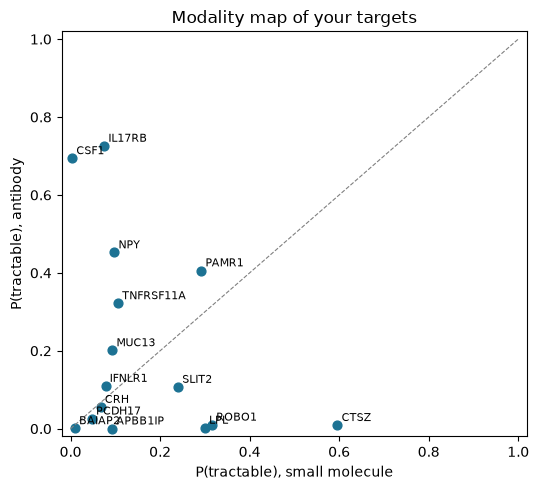

# Target Triage for Type 2 Diabetes with Protein Language Models

*BIOT 6900 · Module 3 Assignment · Rakesh Vayigandla · October 2026*

## Overview

In Module 2 I ranked type 2 diabetes (T2D) targets using islet RNA, plasma proteomics and GWAS evidence. Here I ask whether each of my top 15 targets resembles proteins that already have a clinical drug, and by which modality, using ESM C (300M) embeddings for 20,190 human proteins and a training panel of 1,201 proteins labelled with Open Targets clinical precedence.

**Mapping and leakage.** All 15 targets mapped to `proteome.tsv`, so none were unmapped; all are protein-coding genes with reviewed UniProt entries. One target, CRH, was also in the training panel, so I removed it before fitting, leaving 1,200 training proteins.

## 1. Re-ranking

**Did the prior agree with my Week 2 ranking?** No. Across my 15 targets, the Spearman correlation between the Week 2 score and the best-modality tractability prior was -0.18 (p = 0.52), which is essentially no relationship. This is reasonable: the scores answer different questions ("is this gene involved in T2D?" versus "does it look druggable?"), so they add independent information.

**Table 1. Re-ranked targets** (top 10 of 15; full table in `targets_t2d_w3.csv`).

| Rank | Gene | Week 2 rank | Change | p_sm | p_ab | Nearest drugged proteins (cosine) |
|:--:|:---|:--:|:--:|:--:|:--:|:---|
| 1 | CSF1 | 4 | +3 | 0.00 | 0.69 | IL4R (0.97), PTHLH (0.95), ENG (0.94) |
| 2 | IL17RB | 5 | +3 | 0.08 | 0.73 | IL12B (0.98), RET (0.97), CSF2RA (0.96) |
| 3 | LPL | 1 | -2 | 0.30 | 0.00 | NRP1 (0.97), PLA2G4A (0.96), GUCY2C (0.96) |
| 4 | CRH | 3 | -1 | 0.07 | 0.06 | MAP3K10 (0.89), IL15RA (0.89), E2F1 (0.89) |
| 5 | NPY | 9 | +4 | 0.10 | 0.45 | CACNG3 (0.89), PDE4D (0.89), PDE4C (0.89) |
| 6 | ROBO1 | 7 | +1 | 0.32 | 0.01 | KCNQ3 (0.96), CD74 (0.95), MAP3K13 (0.94) |
| 7 | BAIAP2 | 2 | -5 | 0.01 | 0.00 | HDAC9 (0.95), CACNB2 (0.95), CACNB3 (0.94) |
| 8 | IFNLR1 | 6 | -2 | 0.08 | 0.11 | EPOR (0.98), IL4R (0.97), PDCD1 (0.96) |
| 9 | PAMR1 | 11 | +2 | 0.29 | 0.41 | LAMA4 (0.97), HGF (0.97), NRP1 (0.97) |
| 10 | SLIT2 | 10 | 0 | 0.24 | 0.11 | NRP1 (0.96), PLAU (0.96), PLAT (0.96) |

**Which target moved most, and why?** NPY rose the most (9th to 5th) because its antibody prior is fairly high (0.45). NPY is a small secreted peptide hormone, and secreted signalling molecules are a classic antibody setting. BAIAP2 and PCDH17 fell the most (5 places each). Both have very low priors for either modality: BAIAP2 is an intracellular adaptor protein involved in actin remodelling, with no enzyme pocket and no extracellular surface for an antibody. CSF1 and IL17RB rose to the top because both look strongly like antibody targets, while LPL, my Week 2 #1, dropped to 3rd because its small-molecule prior is only moderate (0.30) and its antibody prior is near zero.

**Justifying w = 0.6.** I weighted Week 2 evidence slightly above tractability because a druggable protein unrelated to T2D is useless, because the prior is only moderately accurate (family-split AUROC 0.745) and measures resemblance rather than an actual binding site, and because it is biased towards families drugged in the past. Against that, my Week 2 scores are tightly bunched (0.858 to 0.927), so percentile ranks exaggerate small differences, which argues against going much higher than 0.6. The result is robust to this choice: for every w from 0.4 to 0.8, the same three genes (CSF1, IL17RB, LPL) make up the top three, and only their order changes (LPL is first for w ≥ 0.7).

## 2. Modality: CSF1 versus LPL

**CSF1** shows the sharpest split: p_ab = 0.69 but p_sm = 0.004. CSF1 (colony stimulating factor 1) is a **secreted cytokine** that controls macrophage survival and differentiation, which is relevant to T2D through adipose-tissue macrophages and inflammation. It signals by binding its receptor CSF1R across a large, flat protein-protein interface. Such interfaces lack a deep pocket for a small molecule but suit antibodies, which bind large surfaces outside the cell. Its nearest drugged neighbours (IL4R, PTHLH, ENG) are all secreted or cell-surface signalling proteins. This matches real drug history: antibodies against CSF1 and against CSF1R have reached clinical trials, while the approved small molecule in this pathway (pexidartinib) targets the kinase domain inside CSF1R, not CSF1 itself.

**LPL** shows the opposite pattern: p_sm = 0.30 but p_ab = 0.002. LPL is an enzyme from the AB hydrolase lipase family, with a catalytic site that is a natural small-molecule pocket, and one of its nearest drugged neighbours is another lipase, PLA2G4A. Interestingly, LPL works outside cells (it is anchored on the surface of capillaries), so an antibody could in principle reach it. The model gives a low antibody score because it judges from sequence family, not location: enzymes in its training panel were mostly drugged with small molecules. In practice, LPL activity is already boosted indirectly by an antibody against its inhibitor ANGPTL3 (evinacumab), which shows that a target's "best" modality can lie on a neighbouring protein.

## 3. Validation

**Table 2. Out-of-fold performance on the training panel (1,200 proteins).**

| Prior | Split | AUROC | Average precision | Chance AP |
|:---|:---|:--:|:--:|:--:|
| Any clinical (Step 3) | Random | 0.844 | 0.724 | 0.334 |
| Any clinical (Step 3) | **Family** | **0.745** | **0.551** | 0.334 |
| Small molecule | Family | 0.745 | 0.477 | 0.252 |
| Antibody | Family | 0.867 | 0.325 | 0.056 |

**Why the family split is the honest number.** In a random split, close relatives from the same protein family end up on both sides of the split, so the model can score well simply by recognising "this looks like a kinase, and kinases are drugged." The family split holds out whole families at once, which is the real situation for my targets: 11 of my 15 targets have no drugged relative anywhere in the training panel (7 have no family annotation at all), so the model has to judge them without a family shortcut. The random split would have overstated performance by about 0.10 AUROC and 0.17 average precision. Honestly measured, the prior beats chance (AP 0.551 vs 0.334) but is far from reliable, which is why I weighted it below Week 2. The antibody prior has a high AUROC, but it rests on only 67 positive proteins, so its probabilities are less stable than the small-molecule prior's.

## 4. Anchor variants

I used **UniProt precursor numbering** throughout, which includes APOE's 18-residue signal peptide (mature-protein names are given in brackets). Scores are log P(mutant) - log P(wild type) from ESM-2 (650M); the percentile is relative to all possible substitutions in the same protein, where low means more surprising.

**Table 3. Anchor variant scores.**

| Variant | Meaning | Score | Percentile |
|:---|:---|:--:|:--:|
| APOE R176C (R158C mature, rs7412) | defines ε2 | -8.56 | 11.8 |
| APOE C130R (C112R mature, rs429358) | defines ε4 | +7.21 | 100.0 |
| TREM2 R47H (rs75932628) | Alzheimer's risk variant | -5.16 | 47.7 |
| TP53 Y220C | cancer hotspot, druggable crevice | -3.80 | 33.4 |

**A strongly negative score is not the same as "pathogenic".** The score only measures how unusual a substitution looks compared with the protein sequences the model learned from during evolution. The APOE results show this clearly. ε2 (R176C) scores as quite damaging, yet ε2 *protects* against Alzheimer's disease; it causes disease mainly when a person carries two copies, in the lipid disorder type III hyperlipoproteinaemia. ε4 (C130R), the strongest common genetic risk factor for Alzheimer's, scores at the very top (+7.2, 100th percentile), meaning the model thinks the risk allele is *more* natural than the normal sequence. That is because arginine at this position is the ancestral form found in other primates; ε4 is "normal" for evolution even though it is harmful in long-lived humans. TREM2 R47H, which raises Alzheimer's risk roughly two- to four-fold, sits in the middle of the distribution (47.7th percentile). The p53 hotspot Y220C scores only moderately (33.4th percentile), even though it drives cancer; it destabilises the protein and opens a surface crevice that is now being targeted by drugs.

**What these models cannot see:** which tissue and cell type the protein is in, how much of it is made, its binding partners, ligands and lipids (which matter a lot for APOE), whether a change is harmful or protective in a given context, gain-of-function effects, protein stability in three dimensions, interactions with other variants, and the environment and lifespan of the person carrying it.

## 5. Limitations and next step

**What sequence alone cannot tell me.** The embeddings capture family and evolutionary similarity, not structure. They cannot show whether a target actually has a pocket that a drug could bind, where the protein sits in the cell, whether it can be reached by an antibody, what it binds, or how it behaves in islets, fat or muscle in a person with T2D. The labels are also historical: they reward resembling proteins that were drugged in the past, so genuinely new target classes are penalised. Finally, I took the larger of p_sm and p_ab as the tractability score, but the two priors were trained with different positive rates (25% for small molecule, 6% for antibody), so their probabilities are not perfectly comparable.

**Two targets for Week 4 structure-based pocket assessment:**

1. **LPL.** It has the strongest disease evidence in my Module 2 analysis (all three layers, top-ranked, known causal genetics), it is an enzyme with a catalytic site, and its small-molecule prior is among the highest in my list. A structural model can test whether its active site or a regulatory site would suit a small-molecule activator, which is what T2D would need, since higher plasma LPL goes with lower T2D risk.
2. **CTSZ.** It has the highest small-molecule prior of all 15 targets (0.60). Cathepsin Z is a cysteine protease from the peptidase C1 family, a family with well-defined active-site clefts that have been targeted with inhibitors. Its Week 2 evidence is weaker (rank 15, moving up to 12), so Week 4 should check whether a genuine, selective pocket exists before investing further.

I would not send CSF1 or IL17RB for pocket assessment despite their top ranks: both are antibody-type targets, where the useful structural question is the shape of the binding interface, not a small-molecule pocket.

## References

1. EvolutionaryScale. ESM Cambrian: revealing the mysteries of proteins with unsupervised learning. 2024. https://www.evolutionaryscale.ai/blog/esm-cambrian (ESM C embedding model).
2. Lin Z, Akin H, Rao R, et al. Evolutionary-scale prediction of atomic-level protein structure with a language model. *Science*. 2023;379(6637):1123-1130. doi:10.1126/science.ade2574 (ESM-2 baseline and variant-scoring model).
3. Buniello A, Suveges D, Cruz-Castillo C, et al. Open Targets Platform: facilitating therapeutic hypotheses building in drug discovery. *Nucleic Acids Research*. 2025;53(D1):D1467-D1475. doi:10.1093/nar/gkae1128.
4. The UniProt Consortium, Bateman A, Martin MJ, et al. UniProt: the Universal Protein Knowledgebase in 2025. *Nucleic Acids Research*. 2025;53(D1):D609-D617. doi:10.1093/nar/gkae1010.
