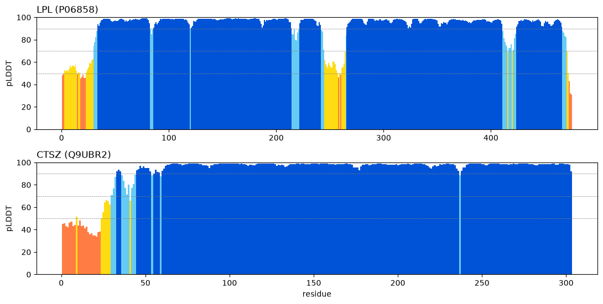

# Structure-Based Druggability of Two Type 2 Diabetes Targets

*BIOT 6900 · Module 4 Assignment · Rakesh Vayigandla · October 2026*

## Overview

In Module 3 a sequence-only prior told me which of my type 2 diabetes (T2D) targets *resemble* drugged proteins. Here I ask whether their structures offer a credible place for a small molecule to bind. I used AlphaFold Database models, checked them against crystal structures, and ran fpocket with the confidence filters from the lab.

**Table 1. Targets.** Both are protein-coding, under 2,700 residues, and have a crystal structure.

| Gene | UniProt | Length | Module 2 rank | Module 3 (p_sm / final rank) | PDB used | Why chosen |
|:--|:--|:--:|:--:|:--:|:--|:--|
| LPL | P06858 | 475 | 1 | 0.30 / 3 | 6OB0 chain A (2.81 Å, small molecule bound) | Top Module 2 target, supported by all three evidence layers; an enzyme with a catalytic site |
| CTSZ | Q9UBR2 | 303 | 15 | 0.60 / 12 | 1DEU chain A (1.70 Å, procathepsin X) | Highest small-molecule prior in Module 3; a cysteine protease from a drugged family |

For each target I chose the entry covering the most residues at good resolution: 6OB0 has 443 LPL residues (more than 6E7K or 6OAU) and is the only LPL entry with a small molecule bound; 1DEU has the best resolution and the most residues for CTSZ. I used chain A of each and UniProt numbering throughout (including signal peptides).

## 1. Which parts can I trust?

**Table 2. Confidence summary.**

| Gene | Mean pLDDT | % > 90 | % < 50 | Stretches ≥ 10 below 50 | Confident domains (PAE) |
|:--|:--:|:--:|:--:|:--|:--|
| LPL | 91.1 | 81.1 | 2.7 | none | 1 domain, residues 30–470 (419 confident) |
| CTSZ | 92.0 | 85.5 | 7.3 | 10–23 | 1 domain, residues 30–303 (273 confident) |

Both models are very high confidence overall, and the low-confidence regions match known biology.

- **LPL.** The N-terminal residues 1–29 (mean pLDDT 54) are the **signal peptide** (1–27), which is cleaved off before secretion. The other weak region is the **lid**, residues 243–266 (mean pLDDT 61). UniProt annotates this segment as determining substrate specificity, and in lipases the lid moves to open or close the active site, so low confidence here is expected: AlphaFold is unsure because the region genuinely has more than one conformation. The PAE finds one domain from 30 to 470, which means AlphaFold is confident about how the catalytic α/β-hydrolase domain and the C-terminal PLAT domain (341–464) sit relative to each other. Using the decision table, I trust the whole 30–470 core for pocket analysis, but treat any pocket built on the lid with caution.
- **CTSZ.** The only disordered stretch, 10–23, is the **signal peptide** (1–23). The propeptide (24–61), which keeps the enzyme inactive until it reaches the lysosome, is mostly confident (mean pLDDT 84) and packs onto the enzyme. CTSZ is a single compact domain, so everything from 30 to 303 is usable. One important point is that AlphaFold models the full precursor, so the model is of the **inactive zymogen**, not the active enzyme.

## 2. How well does each prediction match experiment?

Pairing residues by sequence alignment and superimposing on identical, confident (pLDDT ≥ 70) C-alpha atoms:

| Gene | PDB | Pairs used | RMSD (Å) | Where it differs most |
|:--|:--|:--:|:--:|:--|
| LPL | 6OB0 A | 419 | **0.35** | 410–419 (all < 1 Å), in the PLAT domain |
| CTSZ | 1DEU A | 272 | **0.75** | 52–55 (up to 8.1 Å), in the propeptide; 237 (2.0 Å) |

Both are well inside the 1–2 Å "very close" range, so there was no need for per-domain RMSD (each target has one domain). **For LPL** the largest differences are under 1 Å and sit near 417–421, the loop annotated as binding lipoprotein particles. In the crystal this region sits beside GPIHBP1 and a neighbouring LPL copy, which the single-chain prediction lacks, so I read these small shifts as crystal context rather than prediction error. The crystal also contains calcium, two N-linked glycans and the bound compound, none of which are in the model. The very low RMSD also needs a warning: both crystal structures were in the PDB when the AlphaFold Database models were generated, and AlphaFold can draw on known structures, so this is not a fully independent test.

**For CTSZ** almost all the deviation is concentrated in residues 52–55 of the propeptide. These residues have a confident pLDDT (88–95), so this is a confident disagreement, not a flagged uncertainty. The 1DEU paper describes the propeptide as covalently linked to the active-site cysteine (UniProt disulfide Cys33–Cys92), which constrains how the propeptide lies across the cleft. The short 52–55 loop is the least constrained part of the propeptide, so the difference is most likely a loop placed differently in the crystal (it may also involve crystal packing) rather than a wrong fold. The small 2 Å peak at residue 237 matches a dip in pLDDT there.

## 3. Pockets and druggability calls

**Table 3. Top five pockets per target** (all pass the confidence rules: lining pLDDT ≥ 70 and PAE ≤ 10 Å).

| Gene | Pocket | Score | Rank | Volume (ų) | Lining pLDDT | PAE (Å) | Verdict | Location |
|:--|:--:|:--:|:--:|:--:|:--:|:--:|:--:|:--|
| LPL | 5 | 0.704 | 1 | 647 | 73.2 | 6.6 | keep | lid region (mostly lid 243–266) |
| LPL | 10 | 0.460 | 2 | 379 | 88.0 | 3.6 | keep | **catalytic site** (Ser159, His268) |
| LPL | 1 | 0.247 | 3 | 576 | 95.7 | 1.8 | keep | GPIHBP1-binding surface (31–58) |
| LPL | 6, 8 | 0.069, 0.048 | 4, 5 | 115, 403 | 98.7, 96.1 | ≤ 1.5 | keep | small surface pockets |
| CTSZ | 3 | 0.678 | 1 | 891 | 89.1 | 3.5 | keep | **propeptide (37–45)** against the enzyme (126–147) |
| CTSZ | 13 | 0.082 | 2 | 339 | 98.3 | 0.9 | keep | surface groove (166–185) |
| CTSZ | 4 | 0.052 | 3 | 459 | 79.6 | 5.7 | keep | propeptide start (23–27) + surface 220–267 |
| CTSZ | 19, 8 | 0.013, 0.012 | 4, 6 | 274, 329 | 74.6, 98.4 | ≤ 6.7 | keep | low-scoring surface pockets |

**LPL: "Structure supports a small-molecule pocket."** Pocket 10 is kept, scores 0.46, has high confidence (pLDDT 88, PAE 3.6 Å), and is lined by two of the three catalytic residues (Ser159 and His268). The crystal confirms it: the 6OB0 compound sits in this pocket (Section 6). The top-scoring pocket 5 is less trustworthy: its lining is only just above the cut-off (73.2), because it is built on the mobile lid. It is the kind of pocket that could be different, or not exist, in another lid conformation.

**CTSZ: "Possible but uncertain."** The best pocket (3) has a good score and passes the filters, but its lining includes propeptide residues 37–45. That pocket is formed between the propeptide and the enzyme, so it exists in the inactive precursor and would likely disappear once the propeptide is removed. The real active site (Cys92, His241, Asn261) only touches pockets 2 (score 0.012) and 5 (score 0.000). In the zymogen the propeptide lies over the cleft, so fpocket cannot see an open site. There is also no ligand-bound CTSZ structure to confirm any pocket. The family is clearly druggable (cysteine cathepsins have many inhibitors), so the honest summary is that this structure cannot confirm a pocket, rather than that no pocket exists. I would not move CTSZ to "another modality". It is a lysosomal enzyme, so an antibody cannot reach it inside the cell; a small molecule (or, at most, a degrader) is still the right modality.

## 4. Comparison with Modules 2 and 3

The structure **reverses** the Module 3 picture. The sequence prior ranked CTSZ higher for small molecules (p_sm 0.60 versus 0.30), because CTSZ looks like a family of drugged proteases. The structure, though, gives the stronger, experimentally confirmed pocket to LPL, while CTSZ's best pocket is a precursor artefact. This is exactly the gap between "resembles drugged proteins" and "has a site here".

I would keep **both** targets, but in different roles. **LPL stays first**: it has the strongest disease evidence and a confirmed ligandable site. The open question is the direction of the effect. In my Module 2 data, higher plasma LPL goes with *lower* T2D risk, so a therapy should raise LPL activity. A ligandable active site shows that a small molecule can bind, but an active-site binder is more likely to inhibit than activate. So the indirect route (blocking LPL's inhibitors ANGPTL3/4, which is the antibody route from Module 3) remains a strong alternative. **CTSZ stays as a lower-priority, follow-up target.** Its higher plasma level goes with *higher* T2D risk, so inhibition would be the right direction, which suits a protease. But it needs a structure of the active enzyme before I can make a confident call.

## 5. Limits that apply to my targets

1. **One static structure, no partners or cofactors.** The models are single chains without GPIHBP1, calcium, glycans or the LPL dimer partner, and they show one lid conformation. For LPL, the pockets near the lid and the GPIHBP1 face depend on exactly these. *Next step:* run fpocket on the 6OB0 complex itself, and use molecular dynamics (or several crystal structures) to sample the lid open and closed.
2. **The model may not be the biologically active form.** For CTSZ, AlphaFold predicts the zymogen, so the active-site cleft is covered. *Next step:* repeat the pocket analysis on the mature enzyme, either the 1EF7 crystal structure or the model with residues 24–61 removed, and dock a known cathepsin X inhibitor to see whether its site is found.
3. **Validation is not independent, and pocket scores are not binding.** The near-perfect RMSDs partly reflect that these structures were already in the PDB, and fpocket scores shape, not affinity. *Next step:* a biochemical assay (for example a fragment screen or thermal-shift assay) on purified protein.

## 6. Ligand site (LPL, 6OB0)

6OB0 contains four copies of the small molecule M3D (compound 2) plus two N-acetylglucosamine (NAG) sugars. The sugars are the N-linked glycans on Asn70 and Asn386, not drug sites.

**Table 4. Ligand-site check** (UniProt numbering).

| Ligand copy | Site residues | Best pocket for the site (rank, score) | Coverage | Pocket 5 covers |
|:--|:--|:--|:--:|:--:|
| **M3D A504** | 82, 84, 120–122, **159**, 185, 187, 188, 221, 265, **268** | 10 (rank 2, 0.460, keep) | 0.67 | 0.00 |
| M3D A503 | 82, 84, 262–265 | 10 (rank 2, 0.460, keep) | 0.50 | 0.33 |
| M3D B503, B504 | 415–422 | 31 (rank 38, 0.000) | ≤ 0.50 | 0.00 |

**Is my best kept pocket where the ligand sits? No.** The top kept pocket (5, on the lid) does not overlap the main ligand site at all. **The functional copy is A504**: it contacts the catalytic Ser159 and His268, plus residues 82–84 and 120–122 that line the active site. It is covered best by pocket 10, which ranks **2nd** (score 0.46, kept). A503 sits at the entrance between the active site and the lid, and the two B copies belong to the neighbouring LPL molecule and touch chain A only at 415–422, so they are crystal-contact copies, not functional sites.

**Why might fpocket rank the real site second?** The druggability score rewards deep, enclosed, hydrophobic cavities. The lid region forms a large, greasy groove that scores well even though it is flexible. The catalytic site, by comparison, is smaller (379 ų), more polar (it contains the Ser–His–Asp triad and the oxyanion hole) and partly open where the lid moves. In the apo model, the site is also not shaped around a ligand, so it looks less pocket-like than it does in the crystal.

## 7. Anchor check: p53

From lab Part 2, the AlphaFold p53 model matches the DNA-binding domain in **1TUP chain B** with an RMSD of **0.68 Å** over 192 confident residues (0.73 Å over all 194). Of the hotspots, **C176, H179, C238 and C242 are zinc ligands** (2.1–2.3 Å from the zinc), while **R248 and R273 contact DNA** (3.4 and 2.5 Å); R175, G245, R282 and Y220 are structural. This explains my Module 3 variant scores. The positions the language model found least tolerated (176, 238, 242) are the zinc ligands, where any substitution breaks metal binding, so sequence conservation is strong. Y220C, my Module 3 choice, scored only moderately (33rd percentile) because it lies far from both zinc and DNA (about 29 Å). It harms p53 by destabilising the fold, not by removing a functional contact. Neither zinc nor DNA is in the AlphaFold model, so structure and variant scores both have to be read alongside the crystal.

## References

1. Jumper J, Evans R, Pritzel A, et al. Highly accurate protein structure prediction with AlphaFold. *Nature*. 2021;596(7873):583-589. doi:10.1038/s41586-021-03819-2.
2. Varadi M, Bertoni D, Magana P, et al. AlphaFold Protein Structure Database in 2024: providing structure coverage for over 214 million protein sequences. *Nucleic Acids Research*. 2024;52(D1):D368-D375. doi:10.1093/nar/gkad1011.
3. Le Guilloux V, Schmidtke P, Tuffery P. Fpocket: an open source platform for ligand pocket detection. *BMC Bioinformatics*. 2009;10:168. doi:10.1186/1471-2105-10-168.
4. Arora R, Nimonkar AV, Baird D, et al. Structure of lipoprotein lipase in complex with GPIHBP1. *Proc Natl Acad Sci USA*. 2019;116:10360. doi:10.1073/pnas.1820171116 (PDB 6OB0).
5. Sivaraman J, Nagler DK, Zhang R, Ménard R, Cygler M. Crystal structure of human procathepsin X: a cysteine protease with the proregion covalently linked to the active site cysteine. *J Mol Biol*. 2000;295:939. doi:10.1006/jmbi.1999.3410 (PDB 1DEU).
6. Cho Y, Gorina S, Jeffrey PD, Pavletich NP. Crystal structure of a p53 tumor suppressor-DNA complex: understanding tumorigenic mutations. *Science*. 1994;265:346. doi:10.1126/science.8023157 (PDB 1TUP).
7. The UniProt Consortium. UniProt: the Universal Protein Knowledgebase in 2025. *Nucleic Acids Research*. 2025;53(D1):D609-D617. doi:10.1093/nar/gkae1010.
