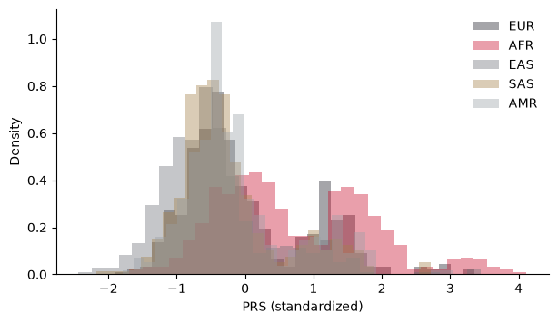
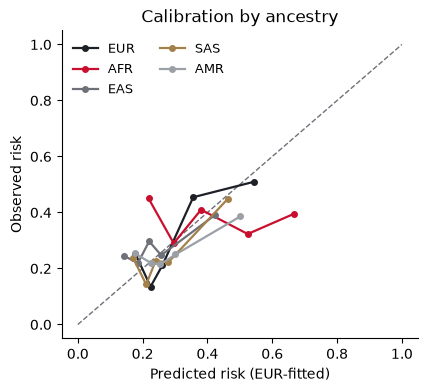
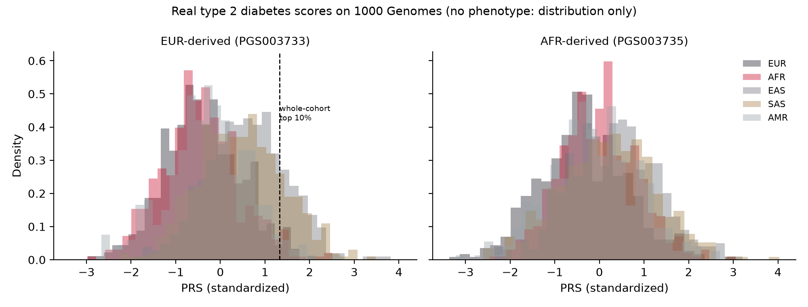

# PRS Portability Across Ancestries: An Alzheimer's Score on 1000 Genomes

*BIOT 6900 · Module 6 Assignment · Rakesh Vayigandla · October 2026*

**Setup.** I applied the PGS Catalog score **PGS000334** (22 SNPs for Alzheimer's disease, including APOE ε4 rs429358 and ε2 rs7412) to 2,336 people from 1000 Genomes phase 3. **The phenotype is simulated.** 1000 Genomes has no disease labels, so the case labels were generated from hidden causal variants in LD with the score SNPs. The PRS values and their distributions are computed from real genotypes, but every AUC and calibration result below is illustrative, not a measurement of real Alzheimer's risk. My earlier modules followed type 2 diabetes, but the provided genotype file contains only these 22 SNPs and the phenotype was simulated from this score, so a T2D score could not be evaluated here (see Section 4).

**Proof of data (Section 2 output):**

```
source      : REAL
people      : 2336
score size  : 22 variants
by ancestry : {'AFR': 500, 'EAS': 500, 'EUR': 500, 'SAS': 489, 'AMR': 347}
  genotypes.csv: sha256 9cf41a1f
  variants.csv: sha256 f7a87d3f
  score.csv: sha256 7f80e8ff
  meta.csv: sha256 6cc55b6e
```

**Harmonization.** All 22 score variants were in the genotype panel (0 not found). 9 were kept as is (effect allele = ALT), **13 were flipped** (effect allele = REF, dosage = 2 − dosage), and 0 were dropped for allele mismatch.

<p> </p>

**Table 1. Results by ancestry** (PRS standardized on the whole cohort; cutoff = whole-cohort top 10%, PRS > 1.49).

| | EUR | AFR | EAS | SAS | AMR | Overall |
|:--|:--:|:--:|:--:|:--:|:--:|:--:|
| Mean PRS (SD) | +0.04 (0.94) | **+0.74** (1.11) | −0.47 (0.81) | −0.25 (0.78) | −0.10 (0.82) | |
| % above the single cutoff | 7.8 | **28.0** | 2.2 | 4.3 | 6.3 | 10 |
| AUC (simulated label) | **0.672** | **0.493** | 0.575 | 0.611 | 0.555 | 0.599 |
| Mean predicted / observed risk | 0.31 / 0.31 | 0.42 / 0.37 | 0.25 / 0.28 | 0.27 / 0.26 | 0.29 / 0.27 | |
| Observed risk above the cutoff | 0.67 (n=39) | 0.39 (n=140) | 0.55 (n=11) | 0.57 (n=21) | 0.50 (n=22) | |

Cross-validated AUC (5-fold): **age alone 0.562, age + PRS 0.618**, so the PRS adds 0.056.

## 1. Why the European-derived score loses accuracy

The score's SNPs are mostly **tags**, chosen in European GWAS because they correlate with a nearby causal variant through linkage disequilibrium (LD). A tag carries risk information only as far as it stays correlated with the causal variant, and that correlation differs between populations. In this cohort the mean tag–causal r² is 0.82 in EUR but **0.44 in AFR** (0.73–0.75 in the other groups), matching the AUC order. African-ancestry genomes are older and more diverse, so LD blocks are shorter and tags break away from causal variants sooner.

**Allele frequencies also differ,** which shifts the whole distribution, not just its accuracy. In these data:

- **APOE ε4** (the C allele of rs429358, the largest weight) has a frequency of **0.26 in AFR**, versus 0.15 in EUR and 0.09 in EAS.
- **rs9896864's** risk-raising G allele is at 35% in AFR but 1–2% in EUR.
- **CR1 rs6656401's** risk allele is at 17% in EUR but under 1% in AFR.

Weights estimated in Europeans are being multiplied by frequencies they were never estimated at. The result is a mean AFR PRS of +0.74 SD, which does not reflect a real 0.74-SD difference in risk.

## 2. One threshold, many groups

A single top-10% cutoff is **not fair**:

- **African-ancestry people:** 28.0% exceed it, almost three times the 10% the threshold implies.
- **East Asian-ancestry people:** only 2.2% exceed it.

The flagged groups also do not carry the same risk. Above the cutoff, observed risk is 67% in EUR but only **39% in AFR**, barely above the AFR base rate of 37%. So in AFR the cutoff mostly flags people at average risk.

If a clinic applied it unchanged:

- **Too many African-ancestry patients flagged.** They would be offered extra screening, anxiety and possibly treatment with no real benefit.
- **Too few East Asian-ancestry patients flagged.** Genuinely high-risk people would be missed.

The cutoff would effectively act on ancestry rather than risk, and it would do so most strongly for the group whose genomes are least represented in the GWAS behind the score.

**The ethics of deploying this score.** The harm here is not random error; it falls along ancestry lines, so an apparently neutral rule produces unequal outcomes.

- **Unequal harm in both directions.** Over-flagging African-ancestry patients means unnecessary worry, follow-up tests, cost and possible insurance consequences for people whose risk is close to average. Under-flagging East Asian-ancestry patients means withholding prevention from people who could benefit. Both groups are worse off than European-ancestry patients, who get the version of the test that works.
- **It would widen an existing gap.** The score fails these groups precisely because they are under-represented in the GWAS it was trained on. Deploying it unchanged would convert a research inequity into a clinical one, and would return the least benefit to the people already least served.
- **Consent and communication.** A number such as "top 10% of risk" carries authority that an AUC of 0.49 does not justify. A patient cannot meaningfully consent to a test whose report does not say how well it performs for someone like them.
- **Who is accountable.** If a clinic acts on this score, the responsibility for a miscalibrated result sits with the people who chose to deploy it without ancestry-specific validation, not with the algorithm.

**What I would require before any clinical use:** ancestry-specific thresholds and calibration; a result report that states the score's measured performance in the patient's own ancestry group; a clear statement that the score is one risk factor among many, not a diagnosis; and a commitment to re-derive it on diverse cohorts rather than patching a European score. A defensible minimum is **ancestry-specific percentiles**, combined with honest reporting that accuracy itself differs between groups. If even that is not possible for a group, the honest option is to not return a score for that group at all.

## 3. Discrimination versus calibration

**Discrimination (AUC)** asks whether the score ranks cases above controls *within* a group. It is moderate in EUR (0.672), essentially **chance in AFR (0.493)**, and in between elsewhere.

**Calibration** asks whether the predicted risks are the right size. A model fitted in EUR sits on the diagonal for EUR (predicted 0.31, observed 0.31). It **over-predicts in AFR** (0.42 vs 0.37), and its AFR curve is flat: observed risk stays around 30–45% whatever the prediction, reaching only 39% where 67% is predicted. It **under-predicts in EAS** (0.25 vs 0.28).

**Where they disagree:**

- **SAS has a reasonable AUC (0.611) and good average calibration**, so ranking survives fairly well there.
- **EAS ranks moderately (0.575), but its absolute risks are shifted.** Its whole distribution sits lower (−0.47) even though its base rate (28%) is close to EUR's.

An AUC alone would hide the EAS shift, because AUC ignores the average level. A calibration-in-the-large check alone would make AFR look only mildly off, because it ignores the loss of ranking. **Both checks are needed**, and they fail in different ways for different groups.

## 4. Clinical utility and limits

**Where it could help.** As a modest add-on in **European-ancestry** research or screening settings. On top of age it adds about 0.056 in AUC (0.562 to 0.618), which could help enrich prevention-trial cohorts, not make individual diagnoses.

**Where it should not be used.** For individual decisions in any group, and especially in African-ancestry patients, where it performs at chance. It should never be used with a single cross-ancestry threshold, and never as a diagnosis: most "high-PRS" people in every group are not cases.

**What I would need before deploying it:**

1. Validation on **real** Alzheimer's diagnoses or biomarkers (amyloid PET, CSF or plasma p-tau) in large **multi-ancestry** cohorts. Examples are All of Us, the Million Veteran Program, UK Biobank's non-European participants, and ADSP cohorts with African-American and Hispanic participants.
2. Ancestry-specific calibration and thresholds.
3. A comparison against APOE genotype alone, which may carry most of this score's value.
4. A multi-ancestry score built from diverse GWAS.

The same logic would apply to my type 2 diabetes targets. A T2D PRS would need a T2D score from the PGS Catalog, a genome-wide 1000 Genomes extract covering its variants, and real T2D labels from a multi-ancestry biobank.

## 5. Artifact versus biology: APOE ε4 in AFR

The near-chance AUC in AFR is partly **built into the simulation**. Each score SNP was given a hidden "causal" proxy chosen by LD **in Europeans**. For ε4, that proxy has **r² ≈ 0.01** with ε4 in African-ancestry genomes. So in this dataset, carrying ε4 barely changes an AFR person's simulated risk, even though ε4 raises their PRS sharply. This is a property of how the labels were made, not a fact about people. In real cohorts ε4 is itself functional: it changes the apoE protein, so it is the cause, not a proxy. It raises Alzheimer's risk in African-ancestry people too, although usually with a smaller effect than in Europeans, which is thought to involve local genetic background around APOE. The lesson is that a simulation can only test what its design allows, and our result shows how fragile tag-based scores are, not that ε4 is unimportant.

## Appendix (not required): the same question on a real type 2 diabetes score

My Part I disease is type 2 diabetes, so I repeated the distribution analysis on **real T2D scores**, outside the graded run. The course genotype file holds only the 22 Alzheimer's SNPs, so I extracted the genotypes a T2D score actually needs directly from the 1000 Genomes phase 3 VCFs (GRCh37) with `bcftools`, for the **same 2,336 people**. I scored two DIAMANTE T2D scores that cover the same 287 positions but were trained in different populations: **PGS003733 (EUR-derived)** and **PGS003735 (AFR-derived)**. Harmonization was clean: 287 of 287 and 276 of 276 variants used, 152 and 148 flipped, **0 allele-mismatch drops and 0 missing genotypes**.

**There is no T2D phenotype for 1000 Genomes,** so this reports the PRS *distribution* only. No AUC or calibration is computed here, and none should be inferred.



| | EUR | AFR | EAS | SAS | AMR |
|:--|:--:|:--:|:--:|:--:|:--:|
| Mean PRS, EUR-derived score | −0.39 | −0.46 | **+0.59** | +0.46 | −0.27 |
| % above the whole-cohort top 10% | 3.0 | 2.8 | **21.0** | 18.0 | 3.5 |
| Mean PRS, AFR-derived score | −0.37 | −0.02 | +0.31 | +0.19 | −0.16 |

**Two findings that reinforce the main report.** First, the distribution shift is **not an artifact of the simulated Alzheimer's cohort**: a real, published T2D score shifts just as sharply across ancestries, and a single top-10% cutoff flags **21% of East Asian-ancestry and 18% of South Asian-ancestry people but only 3% of European-ancestry people**. The affected groups differ from the Alzheimer's case, which confirms that the direction of the shift depends on the specific allele frequencies of each score, not on any general ranking of populations.

Second, the two scores **disagree about the same people**: across all 2,336 individuals the EUR-derived and AFR-derived T2D scores correlate only **r = 0.65**, even though they target the same disease at the same 287 positions. The ancestry of the source GWAS, not the biology of diabetes, is responsible for about a third of the variance in a person's result. That is a concrete argument for deriving scores in diverse cohorts rather than transferring a European score and adjusting it afterwards.

Code and outputs: `t2d_extra/build_t2d_prs.py`, `t2d_extra/t2d_prs_by_ancestry.csv`.

## References

1. Zhang Q, Sidorenko J, Couvy-Duchesne B, et al. Risk prediction of late-onset Alzheimer's disease implies an oligogenic architecture. *Nat Commun*. 2020;11. doi:10.1038/s41467-020-18534-1 (PGS000334).
2. Lambert SA, Gil L, Jupp S, et al. The Polygenic Score Catalog as an open database for reproducibility and systematic evaluation. *Nat Genet*. 2021;53:420-425. doi:10.1038/s41588-021-00783-5.
3. The 1000 Genomes Project Consortium. A global reference for human genetic variation. *Nature*. 2015;526:68-74. doi:10.1038/nature15393.
4. Martin AR, Kanai M, Kamatani Y, et al. Clinical use of current polygenic risk scores may exacerbate health disparities. *Nat Genet*. 2019;51:584-591. doi:10.1038/s41588-019-0379-x.
