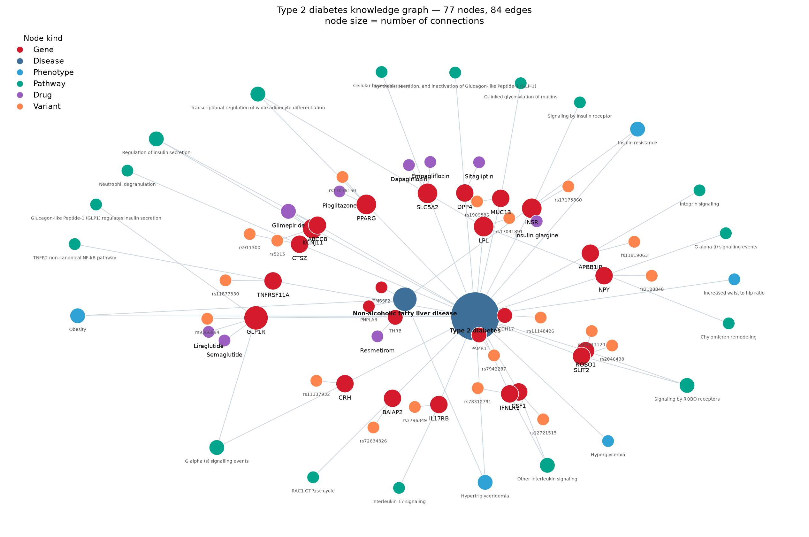

# A Type 2 Diabetes Knowledge Graph: Schema, Centrality and a Repurposing Hypothesis

*BIOT 6900 · Module 7 Assignment · Rakesh Vayigandla · October 2026*

**Disease:** type 2 diabetes (T2D), continuing from Modules 2–4. **Database:** Neo4j AuraDB Free, loaded from the notebook. **Graph size: 77 nodes and 84 relationships.**

| Node kind | n | Relationship | n |
|:--|:--:|:--|:--:|
| Gene | 25 | ASSOCIATED_WITH (gene → disease) | 25 |
| Variant | 19 | PARTICIPATES_IN (gene → pathway) | 22 |
| Pathway | 17 | OCCURS_IN (variant → gene) | 19 |
| Drug | 9 | TARGETS (drug → gene) | 10 |
| Phenotype | 5 | HAS_PHENOTYPE (disease → phenotype) | 8 |
| Disease | 2 | | |



## 1. Schema and evidence

**Why these node types.** The schema is built backwards from the question a target list has to answer: *is this gene worth working on, and is there already a drug near it?* Each node type supplies one piece of that.

- **Gene** is the hub, because every other layer attaches to a gene. The 25 genes are my 15 Module 2 targets, 7 genes that approved T2D drugs act on (so the graph contains real pharmacology, not only my candidates), and 3 genes from the related disease.
- **Variant** nodes carry the causal anchor. Each is the lead variant of that gene's strongest T2D credible set, which is the evidence that the gene is involved at all.
- **Pathway** nodes are what make the graph more than a table: two genes with no direct relationship become connected through a shared pathway, which is how ROBO1 and SLIT2, or LPL and PPARG, end up in the same neighbourhood.
- **Drug** nodes answer "is this tractable", and **Phenotype** nodes are the bridge between diseases.
- A second **Disease**, non-alcoholic fatty liver disease (MASLD), exists specifically so the repurposing query has somewhere to walk. Without a second disease, that query returns nothing.

**Why these edge types.** Each is directional and means one specific thing, so a path can be read as an argument: a drug *targets* a gene, which is *associated with* a disease, which *has* a phenotype shared with my disease.

**Evidence on the edges.** Every edge carries a `source` and a `confidence`, because the whole point of the final question is that edges differ in how much they can bear:

| Edge | Source | Confidence |
|:--|:--|:--|
| ASSOCIATED_WITH | Open Targets GWAS credible set, with `pvalue` and `neg_log10_p` | high if p < 5×10⁻⁸, else suggestive |
| ASSOCIATED_WITH (drug targets) | Open Targets clinical precedence | **low (pharmacology, no GWAS)** |
| PARTICIPATES_IN | Reactome via Open Targets | high (curated) |
| TARGETS | ChEMBL mechanism of action | high (approved drug) |
| OCCURS_IN | Open Targets GWAS lead variant | **medium (lead variant, not proven causal)** |
| HAS_PHENOTYPE | HPO via Open Targets, or curated from the clinical definition | high or **medium** |

**Identifier harmonization.** Gene symbols were resolved to Ensembl IDs through the Open Targets `mapIds` endpoint, and the notebook asserts that the 25 gene nodes carry 25 distinct Ensembl IDs, so no gene can appear twice under two spellings. All nodes also share an `:Entity` label with a uniqueness constraint on `name`, so repeated loads MERGE rather than duplicate.

## 2. Querying it

**The opening question — drugs acting on T2D-associated genes (2 hops).** Nine drug–gene pairs, covering five mechanism classes:

| Drug | Gene | Class |
|:--|:--|:--|
| Sitagliptin | DPP4 | DPP-4 inhibitor |
| Dapagliflozin, Empagliflozin | SLC5A2 | SGLT2 inhibitor |
| Glimepiride | KCNJ11, ABCC8 | sulfonylurea (both K-ATP subunits) |
| Semaglutide, Liraglutide | GLP1R | GLP-1 agonist |
| Pioglitazone | PPARG | thiazolidinedione |
| Insulin glargine | INSR | insulin analogue |

Glimepiride returning **two** genes is a useful check that the graph is behaving: the sulfonylurea receptor is a complex of KCNJ11 and ABCC8, and both edges exist, so the query finds both.

**The shared-symptom extension (5 hops).** One candidate came back. The full path, with the evidence carried on each edge:

```
(Resmetirom) -[TARGETS]-> (THRB)
    source: ChEMBL mechanism of action | confidence: high (approved drug)
(THRB) -[ASSOCIATED_WITH]-> (Non-alcoholic fatty liver disease)
    source: Open Targets clinical precedence | confidence: LOW (pharmacology, no GWAS)
(Non-alcoholic fatty liver disease) -[HAS_PHENOTYPE]-> (Insulin resistance)
    source: HPO term, curated from the clinical definition | confidence: medium
(Insulin resistance) <-[HAS_PHENOTYPE]- (Type 2 diabetes)
    source: HPO via Open Targets | confidence: high
```

Shared phenotypes: insulin resistance, obesity and hypertriglyceridemia.

## 3. Prioritization and communities

**PageRank, and why it must be read carefully.** The top of the PageRank list is GLP1R (0.0217), then PPARG, INSR and SLC5A2 (0.0165), then KCNJ11 (0.0139). Every one of those is an **existing, approved drug target**.

That is not a discovery; it is **circularity**, and it is the most important thing to say about this result. PageRank rewards nodes with many connections, and the genes with many connections are the ones I attached drugs and pathways to, *because* they are already drugged. A graph built partly from pharmacology will rank pharmacology highly. Read honestly, PageRank here is a sanity check that the graph is wired correctly, not a biomarker discovery.

**Fusing centrality with evidence.** To get something that is not purely a popularity contest, I combined PageRank with the Module 2/3 evidence already on the gene nodes: GWAS −log₁₀ p, druggability prior, and the absolute plasma protein effect, each as a percentile rank, averaged.

| Rank | Gene | PageRank | GWAS −log₁₀p | Druggability | Protein effect |
|:--:|:--|:--:|:--:|:--:|:--:|
| 1 | GLP1R | 0.0217 | 21.3 | 1.00 | — |
| 2 | PPARG | 0.0165 | 77.5 | 1.00 | — |
| 3 | KCNJ11 | 0.0139 | 107.0 | 1.00 | — |
| **4** | **TNFRSF11A** | 0.0113 | **20.7** | 0.32 | **0.91** |
| 5 | INSR | 0.0165 | 13.5 | 1.00 | — |
| 6 | LPL | 0.0113 | 20.7 | 0.30 | 0.84 |
| 7 | CSF1 | 0.0113 | 14.0 | 0.69 | 0.66 |

Ranks 1–3 and 5 are the known drug targets again. **The non-obvious hit is TNFRSF11A at rank 4** — the only gene in the top five that no approved T2D drug touches. It earns its place on evidence rather than connectivity: a strong T2D credible set (p = 2×10⁻²¹) and the **largest plasma protein effect of any gene in my Module 2 list** (|log₂ HR| = 0.91). TNFRSF11A encodes RANK, the receptor for RANKL, which sits in the TNFR2 non-canonical NF-κB pathway — an inflammatory axis, consistent with the CSF1 and IFNLR1 immune signal I flagged in Module 2. It is not an obvious diabetes gene, which is exactly why it is worth a second look.

**Communities.** Modularity clustering split the graph into 17 communities, and they are mechanistically coherent rather than arbitrary. **Community 6** is the clearest to interpret: `{KCNJ11, ABCC8, Glimepiride, Regulation of insulin secretion, rs5215}`. That is a complete, self-contained mechanism — two subunits of the K-ATP channel, the pathway they act in, the drug that blocks them, and the lead variant they share (rs5215 maps to both genes, which is why they cluster). It reads as a **β-cell insulin-secretion module**: this is the sulfonylurea mechanism, recovered from the data without being told. Clinically it is the subtype where secretion, not insulin resistance, is the defect. Community 0 is its modern counterpart (GLP1R, semaglutide, liraglutide, the GLP-1 pathway), and community 2 is a lipid/adipocyte module (LPL, PPARG, pioglitazone).

## 4. A hypothesis from a path, and what would test it

**Hypothesis.** *Resmetirom, a thyroid hormone receptor-β agonist approved for MASH, may improve insulin resistance in type 2 diabetes.* The graph reached it without being told anything about diabetes drugs: it walked from T2D to insulin resistance, across to fatty liver disease, down to THRB, and up to the drug. The mechanistic story is plausible, because THR-β activation in the liver reduces hepatic fat, and hepatic fat is tightly coupled to hepatic insulin resistance, which is the shared phenotype the path turned on.

**What would test it.** In order of cost:
1. **Check it is not already known.** Query ChEMBL and ClinicalTrials.gov for resmetirom trials with glycaemic endpoints. The graph only knows what I loaded into it; the literature may have answered this already.
2. **Human genetics, as a free experiment.** Mendelian randomization using THRB variants as instruments, asking whether genetically higher THR-β signalling lowers T2D risk. If the genetics point the other way, the hypothesis is dead before any wet work.
3. **Direct measurement.** A hyperinsulinaemic-euglycaemic clamp, or at minimum HOMA-IR plus liver fat by MRI-PDFF, in patients already on resmetirom for MASH. This is the real test, and it is cheap because the population already exists.

**What would change my mind:** if liver fat falls but insulin sensitivity does not move, the shared-phenotype link is coincidental rather than causal, and the path is an artefact of how I defined the phenotypes.

## 5. An edge is evidence, not truth

**My weakest edges, and why it matters here.**

1. **The `HAS_PHENOTYPE` edges are the weakest, and they carry the most weight.** Open Targets lists only two HPO terms for T2D (insulin resistance, increased waist-to-hip ratio); I added hyperglycemia, obesity and hypertriglyceridemia from the clinical definition, marked `medium` confidence. **All three shared phenotypes in my repurposing path are edges I curated myself.** The single most interesting result in this assignment rests on its least defensible evidence. With a proper disease ontology mapping (MONDO/EFO phenotype annotations rather than my judgement), that path might not exist — or many more would, which is just as informative.
2. **`THRB —ASSOCIATED_WITH→ MASLD` is labelled `low (pharmacology, no GWAS)`.** THRB is in the graph because a drug targets it, not because genetics implicates it. The repurposing path therefore passes through a link that means only "someone made a drug for this".
3. **`OCCURS_IN` assumes the lead variant is the causal one.** It usually is not; it is the tagging variant of a credible set, and the gene assignment at a GWAS locus is itself a modelling choice.
4. **Every edge is undirected in meaning.** `ASSOCIATED_WITH` does not record whether the gene raises or lowers risk. For LPL that distinction is the whole therapeutic question — higher plasma LPL is *protective* — and the graph cannot represent it. This is a schema limitation I would fix first.

**How better data would change the answer.** Adding effect direction and a tissue attribute to `ASSOCIATED_WITH`, and replacing curated phenotypes with ontology-derived ones, would change both outputs: the repurposing query would become trustworthy or disappear, and the biomarker ranking could separate "inhibit this" from "activate this" instead of treating all association as equal.

**Where I used AI, and how I checked it.** I used an AI assistant (Claude) for three things in this module: writing the Cypher and the harmonization code, choosing which Open Targets API fields to query, and drafting prose for this report. Every number in the graph was then pulled programmatically from Open Targets rather than typed from the model's memory, which is the check that matters — an AI asked to recall a p-value will produce a plausible one. Specifically: gene–Ensembl mappings came from the `mapIds` endpoint and are asserted unique in the notebook; GWAS p-values and lead variants came from `credibleSet` records; pathways from Reactome via the API; and drug–target pairs from ChEMBL mechanisms filtered to approved status. The two places I did **not** have an API to lean on are the three curated HPO terms and the choice of MASLD as the related disease, and both are flagged above as the graph's soft spots. I also verified the loaded graph by querying it back (77 nodes, 84 edges, 25 distinct Ensembl IDs) rather than trusting the load step.

## References

1. Buniello A, Suveges D, Cruz-Castillo C, et al. Open Targets Platform: facilitating therapeutic hypotheses building in drug discovery. *Nucleic Acids Research*. 2025;53(D1):D1467-D1475. doi:10.1093/nar/gkae1128.
2. Milacic M, Beavers D, Conley P, et al. The Reactome Pathway Knowledgebase 2024. *Nucleic Acids Research*. 2024;52(D1):D672-D678. doi:10.1093/nar/gkad1025.
3. Zdrazil B, Felix E, Hunter F, et al. The ChEMBL Database in 2023. *Nucleic Acids Research*. 2024;52(D1):D1180-D1192. doi:10.1093/nar/gkad1004.
4. Gargano MA, Matentzoglu N, Coleman B, et al. The Human Phenotype Ontology in 2024. *Nucleic Acids Research*. 2024;52(D1):D1333-D1346. doi:10.1093/nar/gkad1005.
5. Neo4j, Inc. Neo4j AuraDB. https://neo4j.com/cloud/aura/ (graph database used for this assignment).
