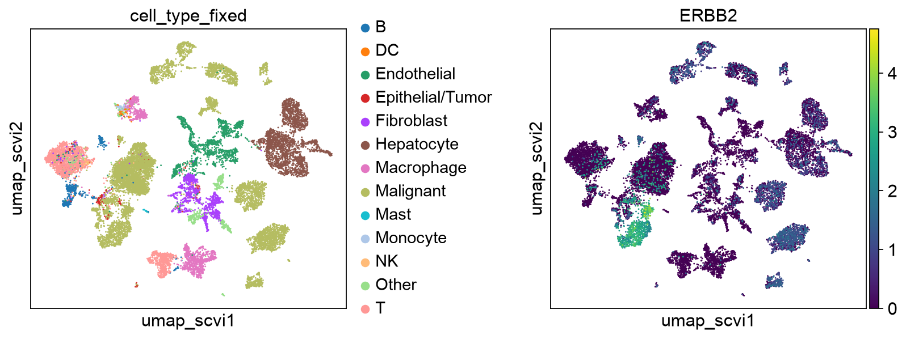
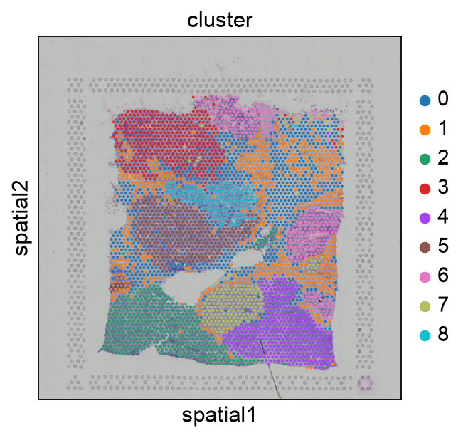
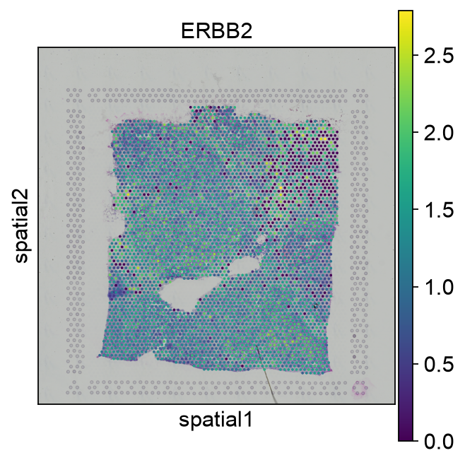

# Module 8: Single-Cell and Spatial Omics
## HER2 (ERBB2) in breast cancer: which cells carry the target, and where they sit

Rakesh Vayigandla · BIOT 6900 · Module 8

---

## 1. Question and design

Breast cancer is treated on the basis of HER2. Trastuzumab, and more recently the HER2 antibody-drug conjugates, all depend on the same assumption: that **ERBB2 protein sits on malignant cells and not on the normal cells around them**, and that a drug can physically reach it. This report tests both halves of that assumption on real data: the first with single-cell transcriptomics across ten donors, the second with a spatial section of a tumor.

Neither view suffices alone: dissociated single-cell data says *which cell type* expresses a gene but destroys tissue geometry, while spatial data preserves geometry but cannot resolve single cells at 55 µm.

**Target: ERBB2 (HER2)**, the defining actionable target in breast cancer, so a correct analysis should recover a known answer, making this a test of method as much as biology.

| | Part 1: single-cell | Part 2: spatial |
|---|---|---|
| Source | CZ CELLxGENE Census, version 2025-11-08 | 10x Visium, `V1_Breast_Cancer_Block_A_Section_1` |
| Query | `disease == 'breast cancer' and is_primary_data == True` | n/a |
| Pool | 1,101,430 cells | n/a |
| Sampled | 10 whole donors × 2,000 cells = 20,000 | 3,798 spots × 36,601 genes |
| After QC | **18,388 cells** | 3,798 spots |
| Integration | scVI (60 epochs, CPU) and Harmony, on 2,000 HVGs | n/a |
| Clustering | n/a | Leiden, resolution 0.6 → **9 domains** |

---

## 2. Part 1: Which cells express ERBB2

### 2.1 The batch effect is real and has to be removed first

Before integration the embedding is organized by **donor, not biology**. The donor silhouette on the unintegrated PCA is **+0.095**: positive, meaning a cell sits closer to other cells from its own patient than to cells of its own type from another patient. The same cell type appears repeatedly as separate donor islands.

### 2.2 Integration: Harmony beats scVI on this dataset

Both methods were scored on the same 5,000-cell subsample, using silhouette against `donor_id` (batch mixing, lower is better) and against the broad cell-type label (biology preserved, higher is better).

| method | batch silhouette ↓ | bio silhouette ↑ | bio - batch |
|---|---|---|---|
| No integration | 0.089 | 0.007 | -0.082 |
| **Harmony** | **-0.076** | **0.043** | **0.119** |
| scVI | -0.032 | 0.035 | 0.068 |

Both fix the batch problem: the donor silhouette moves from **+0.089** to negative in both cases, so donors become interleaved rather than separated. But **Harmony dominates on both axes at once**: it mixes donors harder *and* retains more cell-type structure, for a combined score roughly double scVI's. There is no trade-off to settle.

**I used Harmony.** The expensive deep-learning method did not beat the simple one. It lost on both axes while costing far more: Harmony converged in under a second, scVI required 60 epochs of CPU training.

Three caveats. **(1)** scVI is handicapped: the notebook trains 200 epochs on GPU and falls back to 60 on CPU, which is what ran, so it is likely undertrained and a GPU run could narrow the gap. **(2)** scVI is stochastic (±0.005 between runs); Harmony and the baseline are reproducible. **(3)** All absolute silhouettes are small: this ranks the methods, it does not claim any separates biology strongly.

### 2.3 A labelling bug that inverts the biological answer

The straightforward reading of the target table is **wrong**, and the way it is wrong is instructive.

Using the provided `broad_type()` labels, ERBB2 appears highest in **T cells** (mean 0.52, 29.4% of 10,880 cells), with Epithelial/Tumor near the bottom at 0.15. That is not a believable result: ERBB2 is HER2, an epithelial receptor tyrosine kinase, and not a T-cell gene.

The cause is a **substring match** in the provided helper. It tests `"t cell" in ct`, and the Census label `"malignant cell"` ends in the characters `"t cell"`. Every malignant cell is therefore silently relabeled `T`. The same trap catches `"mast cell"` and `"myofibroblast cell"`.

> Of the **10,880** cells labeled `T`, **8,526, or 78%, are actually `malignant cell`.**

I left `broad_type()` exactly as provided and re-derived the labels in a clearly marked extra cell. With the labels corrected:

| cell type | mean ERBB2 | % expressing | n |
|---|---|---|---|
| **Malignant** | **0.64** | **36.8** | 8,526 |
| Hepatocyte | 0.21 | 18.8 | 2,473 |
| Epithelial/Tumor | 0.15 | 14.5 | 152 |
| **T (genuine)** | **0.06** | **2.5** | 2,313 |
| Macrophage | 0.05 | 3.0 | 1,189 |
| Endothelial | 0.04 | 3.8 | 1,431 |
| Monocyte | 0.00 | 0.0 | 73 |

**ERBB2 is ~10.7× higher in malignant cells than in genuine T cells**, and is effectively absent from myeloid and endothelial compartments. This is the tumor-cell-intrinsic pattern that gives HER2 its therapeutic window, and it only becomes visible once the labels are right.

The broad labels were independently sanity-checked against canonical markers: CD3D is highest in T (0.31), MS4A1 in B (1.65), CD14 in Monocyte (1.57), PECAM1 in Endothelial (2.11), COL1A1 in Fibroblast (2.69). The non-tumor labels behave correctly; it is specifically the malignant compartment that the helper mis-assigns.

**One finding to carry into the clinic:** hepatocytes (n = 2,473) carry a modest **0.21**. These donors include liver sites, and low-level HER2 on normal tissue is exactly the on-target/off-tumor exposure that drives ADC toxicity.

---

## 3. Part 2: Where those cells sit

### 3.1 Spatial domains correspond to real architecture

Leiden gives **9 domains** (161-732 spots). To relate them to tumor, stroma and immune regions I scored three canonical marker panels per domain, rather than asserting identities from the image.

| domain | tumor/epithelial | stroma | immune | reading |
|---|---|---|---|---|
| **1** | 1.86 | **2.61** | **1.34** | stromal / immune compartment |
| **0** | 2.18 | 2.16 | 1.11 | mixed, stroma-leaning |
| 7 | 2.11 | 2.11 | 0.99 | mixed |
| 5 | **2.61** | 1.61 | 0.85 | tumor-rich |
| 8 | 2.50 | 1.69 | 0.76 | tumor-rich |
| 4 | 2.33 | 1.73 | 0.76 | tumor-rich |
| 2 | 2.26 | 1.92 | 0.76 | tumor-rich |

**Domain 1 is the stromal/immune compartment** (highest stroma and immune, lowest epithelial); **domain 0** adjoins it as a mixed zone; **domains 5, 8, 4, 2** are epithelial-rich tumor territory with the lowest immune scores.

Moran's I provides independent confirmation that these are genuine tissue structures and not clustering artifacts. The top spatially variable genes are coherent programmes, all at FDR ≈ 0:

| gene | Moran's I | programme |
|---|---|---|
| MGP | 0.869 | extracellular matrix / stroma |
| MALAT1 | 0.763 | ubiquitous nuclear lncRNA |
| CRISP3 | 0.726 | breast secretory epithelium |
| CPB1 | 0.711 | breast secretory epithelium |
| IGHG3, IGLC2, IGKC, IGHG1, IGHG4 | 0.632-0.704 | plasma-cell immunoglobulin |

Matrix, epithelial and plasma-cell programmes each occupy coherent, contiguous territory, which is what "spatially variable" should mean.

### 3.2 The tissue is immune-excluded

Neighborhood enrichment shows a **strongly compartmentalized** section. Every domain is massively self-enriched (diagonal z = **+75.9 to +96.4**), and of the 36 off-diagonal pairs, **35 are negative**.

Exactly one pair is adjacent more than chance: **domain 0 and domain 1, z = +7.9**, a **stromal/immune boundary**, not a sharp tumor/immune front. The strongest avoidances are the tumor-rich domains against that pair: 0-2 (**-24.0**), 1-2 (**-22.2**), 0-4 (**-21.5**).

**There is no infiltrative tumor/immune boundary here.** Immune cells are banked *alongside* tumor nests rather than penetrating them: the **immune-excluded** phenotype, the pattern associated with poor response to therapies requiring immune effector cells to reach tumor cells.

### 3.3 ERBB2 occupies the tumor core

| domain | mean ERBB2 | % spots | reading |
|---|---|---|---|
| **5** | **1.65** | 99.5 | most epithelial |
| **4** | **1.64** | 99.5 | tumor-rich |
| 8 | 1.53 | 100.0 | tumor-rich |
| 7 | 1.41 | 96.5 | mixed |
| 3 | 1.38 | 97.3 | tumor-rich |
| 2 | 1.35 | 99.2 | tumor-rich |
| 6 | 1.32 | 96.1 | tumor-rich |
| **0** | **1.22** | 80.3 | mixed, stroma-leaning |
| **1** | **0.98** | 83.4 | stromal / immune |

ERBB2 is detected in nearly every spot (80-100%) but is clearly **graded**: highest in the most epithelial domains and **lowest in exactly the stromal/immune pair**. The spread is 1.7× top to bottom, and the ordering tracks the tumor/epithelial panel score.

---

## 4. Connecting the two views

The single-cell and spatial analyses are mutually confirming, and each supplies what the other cannot.

**The single-cell view establishes cell-type identity.** ERBB2 is ~10.7× enriched in malignant cells over genuine T cells and near-absent from myeloid and endothelial compartments: a tumor-cell-intrinsic antigen.

**The spatial view establishes accessibility.** Those ERBB2-high regions are the epithelial-rich domains (5, 4, 8), and the domains lowest in ERBB2 are precisely the stromal/immune pair (1 and 0). The ERBB2-high domains are also those that most strongly *avoid* the immune compartment: 5-0 at z = -11.6, 4-0 at z = -21.5.

> **The antigen is concentrated exactly where immune cells are least present.**

Neither dataset could establish this alone. The single-cell data has no geometry: it cannot distinguish a target at an accessible invasive margin from one locked inside a tumor core. The spatial data cannot resolve cell types at 55 µm: it cannot say whether ERBB2 signal comes from tumor cells or from stroma inside the same spot. Together they place a tumor-intrinsic antigen in an immune-excluded core.

### Clinical reading

**This cuts both ways, and the direction depends on the drug's mechanism.**

*Favorable for an ADC.* The antigen is abundant, tumor-intrinsic and present across the whole section with no antigen-negative region to seed escape; an ADC need only bind and internalise, converting antigen abundance into payload delivery.

*Unfavorable for T-cell-dependent therapy.* A bispecific T-cell engager or checkpoint inhibitor needs T cells already inside the tumor. Here they are excluded, parked in domains 1 and 0, which the ERBB2-high domains actively avoid.

*Delivery and safety.* A core target is gated by stromal penetration, whereas one at an invasive margin is reachable from circulation. This is why the spatial result changes the therapeutic calculus rather than merely illustrating it. Against that, hepatocyte ERBB2 (0.21, 18.8% of 2,473 cells) is the classic on-target/off-tumor risk for a potent payload, and would need dose-limiting attention.

---

## 5. Limitations

### Single-cell

**Donor count.** Ten donors, 2,000 cells each. Whole-donor sampling was used so batch-aware steps have enough cells per donor, but ten patients cannot support claims about HER2 heterogeneity across breast cancer as a disease. Two donors (`pal_Patient 0056`, `pal_Patient 0178`) were sequenced on the shallower 10x 3′ v2 chemistry while the rest used 3′ v3 or 5′ v2, so sequencing depth is confounded with donor.

**Label resolution: the dominant limitation.** This analysis would have reported the *opposite* conclusion without inspecting the labels: `broad_type()` mis-assigned 78% of the `T` compartment, and the error was detectable only because ERBB2's correct answer was known in advance. **For a novel target there would have been no such alarm.** The helper also collapses all T-cell subtypes into one bucket, so exhausted, regulatory and cytotoxic T cells are indistinguishable. 2,473 hepatocytes and 503 residual `Other` cells show the query also pulled non-breast tissue.

**Compositional caveat.** The malignant fraction (8,526 of 18,388) reflects which donors and dissociation protocols are in the Census, not true tumor cellularity.

### Spatial

**Spot resolution.** A 55 µm Visium spot holds roughly 1-10 cells, so every measurement is a mixture. Near-universal ERBB2 positivity partly reflects this dilution and does **not** mean every cell is HER2-positive. The between-domain ranking is trustworthy; per-spot detection rates are not.

**No segmentation.** No cell-segmentation or deconvolution step was applied, so domain identities are *aggregate* labels. "Tumor-rich" means the spot is dominated by epithelial signal, not that it is pure tumor. The marker-panel `call` column is accordingly crude: 8 of 9 domains take their maximum on the tumor/epithelial panel because those genes are broadly expressed, so only the relative ranking carries signal.

**One section, one patient.** Part 2 is a single section from a single block. The immune-excluded phenotype is a property of *this* tumor and cannot be generalised, and the section is not from any of the ten Part 1 donors. The two parts are joined by biology, not by patient identity.

**Panel and depth.** Moran's I was computed on 2,000 highly variable genes, so a spatially structured gene outside that set would be missed. MALAT1 ranking second is a reminder that technical gradients can masquerade as spatial biology.

---

## 6. Reproducibility

The notebook runs top to bottom with Restart & Run All. Three fixes were required because the provided starter does not execute on a current package stack; all are documented in the README.

| # | Location | Problem | Fix |
|---|---|---|---|
| 1 | Provided QC cell | `seurat_v3` HVG loess fit singular: the two 10x 3′ v2 donors have ~720 distinct mean values across ~14,600 genes, producing heavily tied data | `span=0.5` (scanpy default 0.3). The only edit to any provided cell; `flavor`, `n_top_genes`, `layer` and `batch_key` unchanged |
| 2 | Provided `sc.pp.neighbors` | pynndescent 0.7.0 returns `csr_array`; scanpy 1.11.5 calls `.getnnz()`, which exists only on `csr_matrix` | Pinned `pynndescent==0.5.13`. No code change |
| 3 | Provided scVI cell | Segfault (SIGSEGV) on the first training batch, from OpenMP thread contention | `OMP_NUM_THREADS=1`. Environment only, no code change |

Fixes 2 and 3 are environment-level, so those cells are byte-identical to the template. Peak memory 0.72 GB; CPU-only.

**Sources.** CZ CELLxGENE Census 2025-11-08 (`cellxgene-census`); 10x Genomics Visium `V1_Breast_Cancer_Block_A_Section_1` via `scanpy.datasets.visium_sge`. Software: scanpy 1.11.5, squidpy 1.8.2, scvi-tools 1.4.2, harmonypy, scikit-learn 1.9.1.
