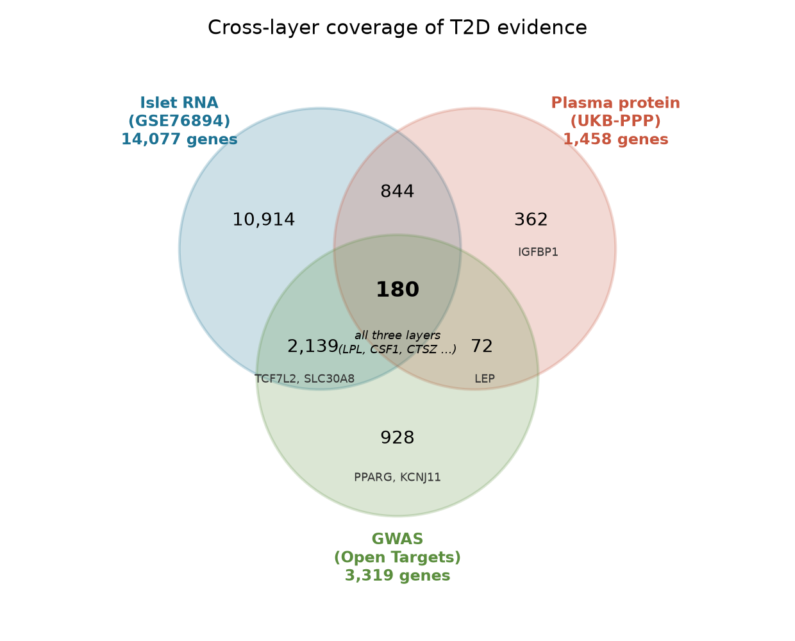
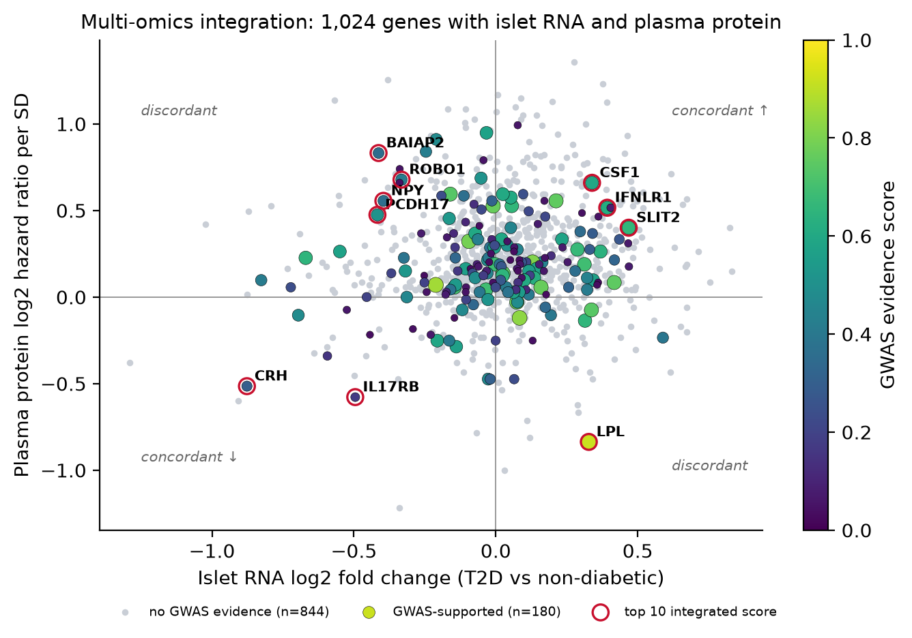
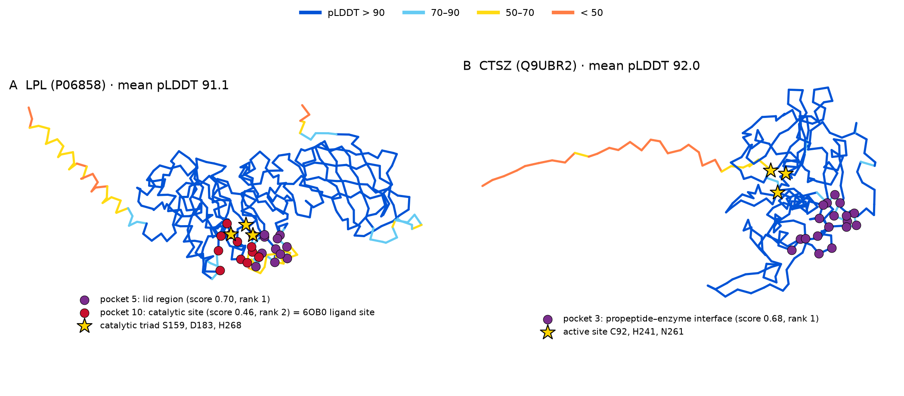

# From Multi-Omics Evidence to a Structurally Characterized Target Shortlist for Type 2 Diabetes

*BIOT 6900 · Portfolio Deliverable 1 · Rakesh Vayigandla · October 2026*

## 1. Disease and question

Type 2 diabetes (T2D) affects hundreds of millions of people. Current drugs (metformin, sulfonylureas, GLP-1 agonists, SGLT2 and DPP-4 inhibitors) mainly lower blood glucose rather than correct its causes: insulin resistance, β-cell failure and lipid overload. A **good new target** therefore needs three things:

1. causal support, ideally from germline genetics;
2. a measurable signal in the tissues and blood where T2D develops;
3. a credible way to drug it, either a confident small-molecule pocket or an accessible extracellular protein for an antibody.

This package follows that logic from three independent evidence layers (Lab 2), through a sequence-based druggability prior (Lab 3), to AlphaFold structures (Jumper et al., 2021) and fpocket pocket detection (Le Guilloux et al., 2009) (Lab 4). It ends with a ranked shortlist for a discovery team.

## 2. Multi-omics integration: which genes have evidence in more than one layer?

I combined three **unmatched** datasets at the gene level:

- **Islet RNA:** 14,077 genes, 19 T2D vs 84 non-diabetic organ donors (Solimena et al., 2018).
- **Plasma proteins:** 1,458 Olink proteins measured *before* diagnosis in 47,600 UK Biobank participants, with hazard ratios per SD (Gadd et al., 2024).
- **GWAS:** credible-set evidence for 3,319 genes from Open Targets (Buniello et al., 2025).

Each layer was converted to a rank percentile, and the three were averaged with equal weights.

**Figure 1. Cross-layer coverage.** Only **1,024 genes** have both islet RNA and plasma protein measurements (the surviving set), and **180** of them also have GWAS evidence. Several textbook T2D genes fall outside the triple overlap for data reasons, not biological ones:

- PPARG and KCNJ11 have GWAS data only.
- TCF7L2 and SLC30A8 are not on the plasma panel.
- LEP and IGFBP1 are not islet-expressed.

**Figure 2. Integration of islet RNA and plasma protein for the 1,024 surviving genes,** coloured by GWAS evidence; the top 10 integrated scores are circled.

The layers are largely **independent**:

- RNA and protein effects are barely correlated (Spearman ρ = 0.08).
- Only **557 of 1,024 genes (54%)** change in the same direction in both layers, close to the 50% expected by chance.
- Every top-15 gene has GWAS support. This partly reflects the scoring: 844 genes with no GWAS evidence tie at a low percentile. So genetics acts as the gate, and RNA and protein act as the tie-breakers.

**Recovered known biology.** **LPL** ranks first (GWAS score 0.92). It is also 84th of 9,907 T2D genes in Open Targets, with strong literature support. Higher plasma LPL predicts *lower* T2D risk (HR 0.56 per SD).

**A discordant top hit.** LPL is also discordant: its islet RNA is slightly *higher* in T2D (log2FC 0.33), while plasma LPL is protective. I read this as a tissue and timing effect, not noise:

- Circulating LPL comes from adipose and muscle capillaries, not islets.
- The plasma was sampled years before diagnosis, whereas the islets come from donors with established disease, where LPL may respond to lipotoxicity.

**A non-obvious signal.** The **SLIT–ROBO pathway** appears independently three times: SLIT2 (rank 10), ROBO1 (rank 7) and ROBO2 (rank 21). SLIT2 has solid genetics (GWAS score 0.66) but almost no T2D literature.

## 3. Druggability triage: which candidates look druggable, and by which modality?

Lab 3 trained two **sequence-only priors** on ESM C embeddings (EvolutionaryScale, 2024) of 1,200 clinically labelled proteins: one for small molecules (p_sm) and one for antibodies (p_ab). Each of my targets was held out from training, to avoid leakage. I report the honest **family-split** validation, which holds out whole protein families:

| Prior | AUROC | AP |
|:--|:--:|:--:|
| Any clinical precedence | 0.745 | 0.551 (chance 0.334) |
| Antibody | 0.867 | — |

A random split overstated performance by about 0.10 AUROC. The prior is therefore useful as a filter, not as a verdict. The final Lab 3 score weighted the Lab 2 evidence 0.6 and tractability 0.4. The tractability prior was essentially uncorrelated with the Lab 2 ranking (ρ = −0.18), so the two add independent information.

**Table 1. Druggability of the leading candidates** (Lab 3; the nearest drugged proteins are the evidence behind each prior).

| Gene | Lab 2 rank | p_sm | p_ab | Likely modality | Nearest drugged proteins (cosine) | Lab 3 rank |
|:--|:--:|:--:|:--:|:--|:--|:--:|
| CSF1 | 4 | 0.00 | **0.69** | antibody (secreted cytokine) | IL4R 0.97, PTHLH 0.95, ENG 0.94 | 1 |
| IL17RB | 5 | 0.08 | **0.73** | antibody (cell-surface receptor) | IL12B 0.98, RET 0.97, CSF2RA 0.96 | 2 |
| LPL | 1 | **0.30** | 0.00 | small molecule (lipase active site) | NRP1 0.97, PLA2G4A 0.96, GUCY2C 0.96 | 3 |
| CTSZ | 15 | **0.60** | 0.01 | small molecule (cysteine protease) | MMP14 0.92, ITGB2 0.91, PNLIP 0.91 | 12 |
| BAIAP2 | 2 | 0.01 | 0.00 | none (intracellular adaptor) | HDAC9 0.95, CACNB2 0.95 | 7 |

**What survives.**

- **CSF1 and IL17RB** rise to the top on the antibody prior. Both are extracellular signalling proteins that bind across large, flat interfaces, which suit antibodies.
- **LPL** survives as a small-molecule candidate. One of its nearest drugged neighbours is another lipase.
- **CTSZ** has the highest small-molecule prior of all 15 (0.60), because cysteine cathepsins are a heavily drugged family.
- **BAIAP2**, my Lab 2 #2, drops out. It is an intracellular actin adaptor with no enzyme pocket and no extracellular surface.

The two small-molecule candidates, LPL and CTSZ, went forward to structural assessment.

## 4. Structural assessment: is there a credible pocket?

**Figure 3. AlphaFold models coloured by pLDDT, with fpocket pockets and catalytic residues.** The pockets shown passed the confidence filters (lining pLDDT ≥ 70 and within-pocket PAE ≤ 10 Å).

**Table 2. Structural evidence** (Lab 4; UniProt numbering).

| Gene | Mean pLDDT | Low-confidence regions | Experimental check | Pocket finding | Call |
|:--|:--:|:--|:--|:--|:--|
| LPL | 91.1 | signal peptide 1–29; **lid 243–266 (mean 61)** | 6OB0 chain A, **0.35 Å** RMSD (419 Cα) | catalytic pocket 10 (score 0.46, pLDDT 88) holds the bound compound (67% of its contacts); top pocket 5 sits on the low-confidence lid | **Supports a small-molecule pocket** |
| CTSZ | 92.0 | signal peptide 10–23 | 1DEU chain A, **0.75 Å** (272 Cα); 8 Å local shift at 52–55 | top pocket 3 (score 0.68) is formed with the **propeptide**; the real active site (C92, H241, N261) scores ≈ 0 | **Possible but uncertain** |

**Confidence changes which pocket to believe.**

- **LPL.** fpocket's top-scoring pocket is built on the **lid**. Its lining pLDDT is only 73, and the lid is a mobile loop that opens and closes over the active site. The pocket with experimental support is the **catalytic site**, which ranks second. In the crystal structure 6OB0 (Arora et al., 2019), the small molecule sits there, against Ser159 and His268.
- **CTSZ.** Both the model and the crystal structure 1DEU (Sivaraman et al., 2000) show the **inactive zymogen**. In this form the propeptide covers the cleft, so the strongest pocket is an artefact of the precursor, and the true protease cleft is invisible.

Both models match experiment very closely. However, both structures were already public before the AlphaFold models were made, so this check is not fully independent.

**Structural scope.** Lab 4 called for two targets, and I sent the two **small-molecule** candidates, because a pocket assessment only answers a small-molecule question. The two antibody candidates, CSF1 and IL17RB, were **not structurally modelled in Lab 4**. For an antibody, the relevant structural question is not a pocket but the shape and accessibility of the binding interface. So their next structural step is to model each protein together with its partner, CSF1 with its receptor CSF1R and IL17RB with its ligand IL-25, and then map the interface an antibody would need to block. Until that is done, their rank rests on Labs 2 and 3 alone, and I say so in Table 3.

## 5. Prioritized target package

**Table 3. Final shortlist across all three layers.**

| Rank | Target | Genetic / omics evidence (Lab 2) | Druggability (Lab 3) | Structure (Lab 4) | Proposed route |
|:--:|:--|:--|:--|:--|:--|
| **1** | **LPL** | GWAS 0.92; plasma HR 0.56 (protective); OT rank 84 | p_sm 0.30 | confident fold; ligand-confirmed catalytic pocket | small-molecule *activator/stabilizer*, or indirectly by blocking ANGPTL3/4 |
| **2** | **CSF1** | GWAS 0.59; HR 1.58 (risk); concordant | p_ab 0.69 | not modelled (antibody route) | neutralizing antibody |
| **3** | **IL17RB** | GWAS 0.17; HR 0.67; concordant | p_ab 0.73 | not modelled (antibody route) | antibody, after the direction is resolved |
| **4** | **CTSZ** | GWAS 0.05; HR 1.58 (risk); discordant | p_sm 0.60 | confident zymogen; no confirmed active-site pocket | small-molecule inhibitor (direction fits) |
| watch | SLIT2 / ROBO1 | three independent pathway hits | low priors (≤ 0.32) | — | pathway biology first |

**Why this order.**

- **LPL is first** because it is the only candidate that is strong in **every** layer. It has the best genetics, a protective pre-diagnostic plasma signal, a sequence prior consistent with a lipase, and an experimentally confirmed ligandable site. Its weakness is **direction**. Raising LPL should help, but an active-site binder is more likely to inhibit. So the first programme should screen for activators or stabilizers, with the indirect route of blocking LPL's natural inhibitors ANGPTL3/4 as a parallel option. Human genetics already supports that route: carriers of loss-of-function ANGPTL4 variants have lower T2D risk (Gusarova et al., 2018).
- **CSF1 is second, and it is the most interesting non-obvious hit.** It is concordant across RNA and protein, has a risk-raising plasma signal (HR 1.58, so blocking it is the right direction), is GWAS-supported (0.59), and has the clearest antibody profile. It ranks only 546th in Open Targets, so its T2D link is under-studied. The biology is plausible: CSF1 is the main survival signal for macrophages, and macrophages that accumulate in fat during obesity are a recognized driver of the inflammation that causes insulin resistance. CSF1 therefore points to an immune mechanism of T2D that no current diabetes drug targets.
- **IL17RB is third.** Its antibody prior is high and its layers agree, but its genetics are weaker (0.17), and the protein direction (HR 0.67, protective) argues *against* simply blocking it.
- **CTSZ is fourth.** Inhibiting it fits the direction (its plasma level goes with higher risk), and its family is druggable. But its genetic support is weak, and its structural case is unproven until the active enzyme is modelled.

**Why other high-ranked genes were dropped.** Four genes ranked highly in Lab 2 or Lab 3 but are not on the shortlist:

- **BAIAP2** (Lab 2 #2) has no route to a drug: it is an intracellular actin adaptor, and both of its priors are about 0.01.
- **CRH** (Lab 3 #4) reached that rank on Lab 2 evidence alone; both of its priors are below 0.07. Its direction also argues against inhibition: islet CRH is lower in T2D (log2FC −0.88), and higher plasma CRH goes with lower risk (HR 0.70). If it were pursued, the drug would act on its receptor CRHR1, not on CRH itself.
- **NPY** (Lab 3 #5) has a moderate antibody prior (0.45), but it is a neuropeptide that controls appetite in the brain. Its islet RNA and plasma signal also point in opposite directions (lower in T2D islets, but HR 1.47). So it is a weaker, mechanistically unclear choice than CSF1.
- **PCDH17** (Lab 2 #8) is a cell-adhesion protocadherin with both priors below 0.05.

In each case, the gene has disease evidence but no credible way to drug it. That is exactly what Labs 3 and 4 were designed to filter out.

## 6. Limitations and validation

**What this analysis cannot claim:**

1. **Individual-level conclusions.** The layers come from different people and tissues, so nothing here describes a single patient.
2. **Causality from the plasma or islet signals.** Plasma associations may reflect obesity, and islet changes may be consequences of hyperglycaemia. Only the GWAS layer is causally anchored, and gene assignment at GWAS loci is itself uncertain.
3. **Complete gene coverage.** The plasma panel limits the gene set, which is why PPARG and TCF7L2 drop out.
4. **That sequence resemblance or fpocket shape equals drug binding.** The priors are biased towards historically drugged families, and the AlphaFold models are single, static, apo chains without partners. For LPL that means no GPIHBP1, calcium or dimer partner, and only one lid conformation.

**Validating LPL:**

1. **Human genetics.** Test whether genetically higher LPL activity lowers T2D risk, using Mendelian randomization with LPL and ANGPTL4 variants as instruments.
2. **Biochemistry.** Run a screen of purified LPL–GPIHBP1 for compounds that *increase* triglyceride hydrolysis or stabilize the active dimer, using the 6OB0 catalytic pocket as the docking site.
3. **Physiology.** Take the best hits into human adipocytes and a diet-induced obese mouse, and measure insulin sensitivity and triglyceride clearance.

**What would demote LPL:** a null Mendelian randomization result, or activators that improve lipids without improving glucose control.

## References

Arora, R., Nimonkar, A. V., Baird, D., Wang, C., Chiu, C.-H., Horton, P. A., … Trauger, J. W. (2019). Structure of lipoprotein lipase in complex with GPIHBP1. *Proceedings of the National Academy of Sciences, 116*, 10360. https://doi.org/10.1073/pnas.1820171116

Buniello, A., Suveges, D., Cruz-Castillo, C., et al. (2025). Open Targets Platform: Facilitating therapeutic hypotheses building in drug discovery. *Nucleic Acids Research, 53*(D1), D1467–D1475. https://doi.org/10.1093/nar/gkae1128

EvolutionaryScale. (2024). *ESM Cambrian: Revealing the mysteries of proteins with unsupervised learning* [Blog post]. https://www.evolutionaryscale.ai/blog/esm-cambrian

Gadd, D. A., Hillary, R. F., Kuncheva, Z., et al. (2024). Blood protein assessment of leading incident diseases and mortality in the UK Biobank. *Nature Aging, 4*(7), 939–948. https://doi.org/10.1038/s43587-024-00655-7

Gusarova, V., O'Dushlaine, C., Teslovich, T. M., et al. (2018). Genetic inactivation of ANGPTL4 improves glucose homeostasis and is associated with reduced risk of diabetes. *Nature Communications, 9*, 2252.

Jumper, J., Evans, R., Pritzel, A., et al. (2021). Highly accurate protein structure prediction with AlphaFold. *Nature, 596*(7873), 583–589. https://doi.org/10.1038/s41586-021-03819-2

Le Guilloux, V., Schmidtke, P., & Tuffery, P. (2009). Fpocket: An open source platform for ligand pocket detection. *BMC Bioinformatics, 10*, 168. https://doi.org/10.1186/1471-2105-10-168

Sivaraman, J., Nagler, D. K., Zhang, R., Ménard, R., & Cygler, M. (2000). Crystal structure of human procathepsin X: A cysteine protease with the proregion covalently linked to the active site cysteine. *Journal of Molecular Biology, 295*, 939. https://doi.org/10.1006/jmbi.1999.3410

Solimena, M., Schulte, A. M., Marselli, L., et al. (2018). Systems biology of the IMIDIA biobank from organ donors and pancreatectomised patients defines a novel transcriptomic signature of islets from individuals with type 2 diabetes. *Diabetologia, 61*(3), 641–657. https://doi.org/10.1007/s00125-017-4500-3
